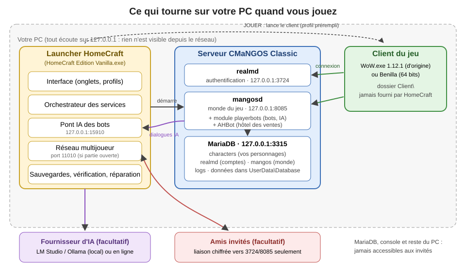
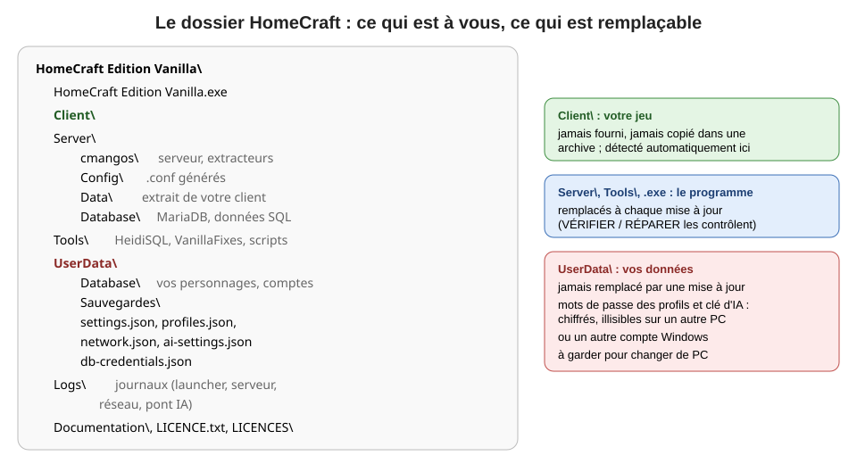
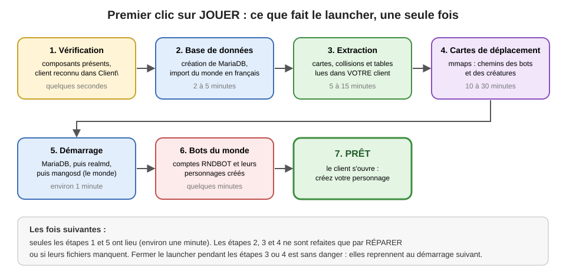
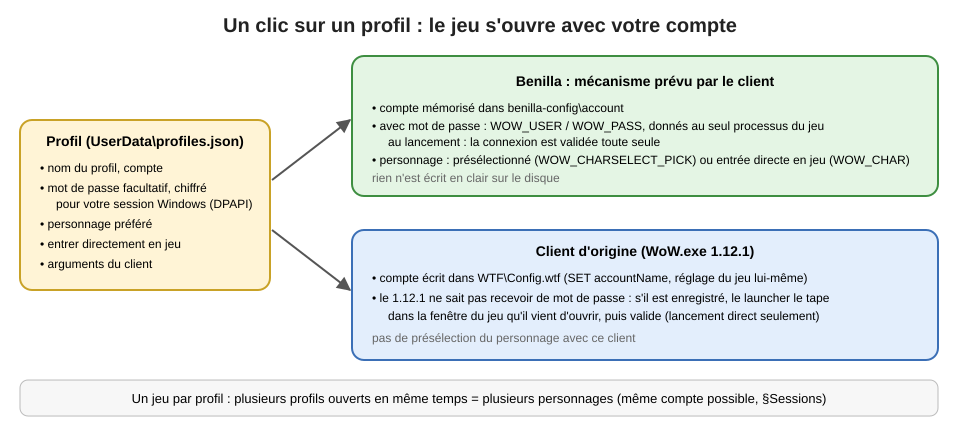
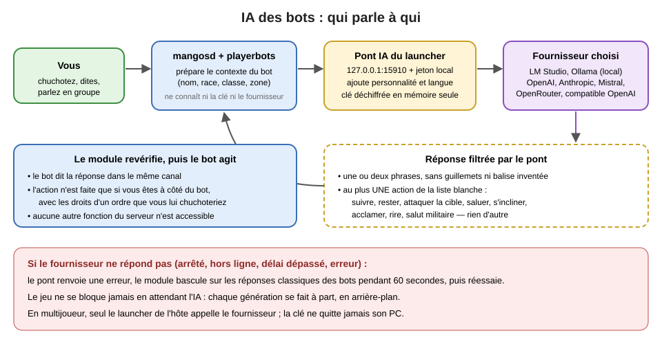
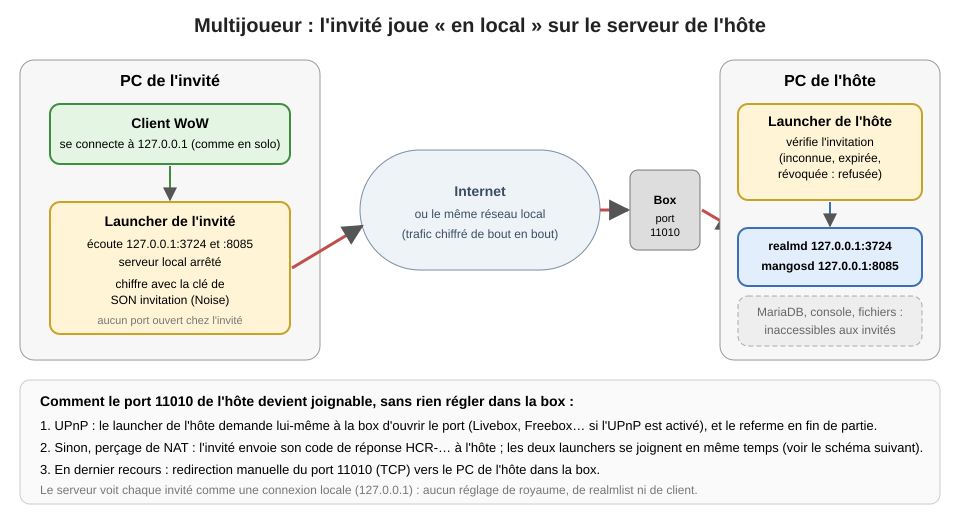
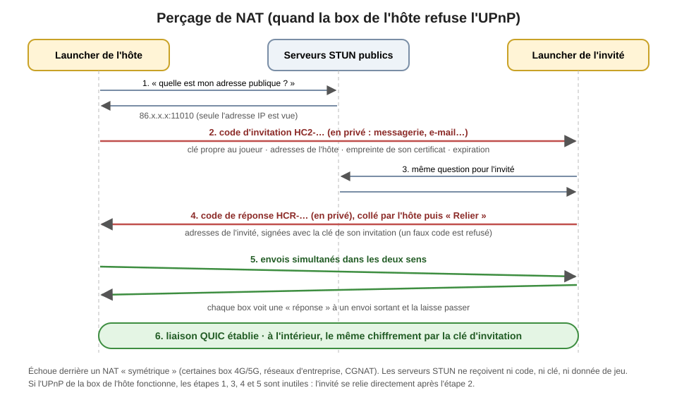
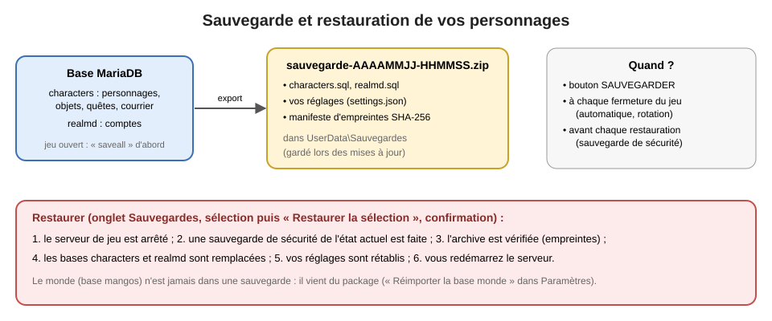

# HomeCraft Edition Vanilla — Manuel d'utilisation

Version du manuel : 2.0 (1er novembre 2026), pour le launcher **1.0.0** (édition CMaNGOS Classic + playerbots).

HomeCraft Edition Vanilla vous permet de jouer à World of Warcraft 1.12.1 (« Vanilla ») **en français, sur votre propre ordinateur**, seul ou avec quelques amis, dans un monde peuplé de bots qui jouent comme des joueurs. Tout est piloté par une seule fenêtre : le **launcher**. Ce manuel décrit tout ce que le launcher sait faire, dans l'ordre où vous en aurez besoin, avec des schémas pour comprendre ce qui se passe « sous le capot ».

> **En trois phrases.** Copiez le dossier, mettez votre client 1.12.1 frFR dans `Client\`, ouvrez `HomeCraft Edition Vanilla.exe` et cliquez sur **JOUER**. Le premier démarrage prépare tout tout seul (de 20 minutes à une heure selon le PC, une seule fois). Ensuite, un clic suffit.

---

## Sommaire

**Prise en main**
1. [Ce que c'est, ce que ce n'est pas](#1-ce-que-cest-ce-que-ce-nest-pas)
2. [Comment ça marche](#2-comment-ça-marche)
3. [Prérequis](#3-prérequis)
4. [Installation](#4-installation)
5. [Premier démarrage pas à pas](#5-premier-démarrage-pas-à-pas)
6. [La fenêtre du launcher](#6-la-fenêtre-du-launcher)

**Jouer**
7. [Onglet Accueil](#7-onglet-accueil)
8. [Profils de lancement](#8-profils-de-lancement)
9. [Onglet Comptes](#9-onglet-comptes)
10. [Jouer avec les bots](#10-jouer-avec-les-bots)
11. [Plusieurs personnages à la fois (multiboxing) et absence (AFK)](#11-plusieurs-personnages-à-la-fois-multiboxing-et-absence-afk)

**Régler**
12. [Onglet PlayerBots](#12-onglet-playerbots)
13. [IA des bots (modèle de langage)](#13-ia-des-bots-modèle-de-langage)
14. [Onglet Monde](#14-onglet-monde)
15. [Onglet Patchs et AddOns](#15-onglet-patchs-et-addons)
16. [Onglet Paramètres](#16-onglet-paramètres)

**Jouer à plusieurs**
17. [HomeCraft Multijoueur](#17-homecraft-multijoueur)

**Entretenir**
18. [Onglet Sauvegardes](#18-onglet-sauvegardes)
19. [Onglet Base de données](#19-onglet-base-de-données)
20. [Onglet Journaux et console du serveur](#20-onglet-journaux-et-console-du-serveur)
21. [Vérifier et réparer l'installation](#21-vérifier-et-réparer-linstallation)
22. [Mettre à jour, déplacer, dupliquer, désinstaller](#22-mettre-à-jour-déplacer-dupliquer-désinstaller)

**Référence**
23. [Sécurité et vie privée](#23-sécurité-et-vie-privée)
24. [Dépannage](#24-dépannage)
25. [Questions fréquentes](#25-questions-fréquentes)
26. [Où sont mes fichiers ?](#26-où-sont-mes-fichiers-)
27. [Options de la ligne de commande](#27-options-de-la-ligne-de-commande)
28. [Glossaire](#28-glossaire)
29. [Mentions légales](#29-mentions-légales)

---

## 1. Ce que c'est, ce que ce n'est pas

**C'est** un serveur de jeu complet (**CMaNGOS Classic**, fidèle au patch 1.12 de 2006, avec le module **playerbots**), une base de données (**MariaDB**) et un programme de pilotage (le **launcher**), réunis dans un seul dossier, sans rien installer dans Windows.

**Ce n'est pas** le jeu lui-même. Le client World of Warcraft 1.12.1 (le dossier avec `WoW.exe` et `Data\`) appartient à Blizzard Entertainment et **n'est jamais fourni** : vous apportez le vôtre, en version française. HomeCraft n'est pas un service en ligne, pas un serveur public, et n'a aucun lien avec Blizzard.

**Ce que HomeCraft apporte**

| Domaine | Ce que vous obtenez |
|---|---|
| Monde vivant | des centaines de **bots** qui montent de niveau, font leurs quêtes, chassent, commercent, vont en donjon et en champ de bataille, forment des groupes et des guildes |
| Compagnons | des bots qui rejoignent votre groupe, vous suivent, combattent, soignent, obéissent à vos ordres |
| IA des bots | (facultatif) des bots qui vous répondent avec un modèle de langage local ou en ligne |
| Confort | hôtel des ventes approvisionné, réglages du monde (expérience, butin, difficulté, factions) sans toucher un fichier |
| Français | traductions complétées là où la base d'origine était en anglais |
| Lancement | profils : un clic pour lancer le jeu avec votre compte et votre personnage préféré |
| Multiboxing | plusieurs personnages d'un même compte connectés en même temps |
| Multijoueur | une partie privée avec vos amis, sans serveur central, sans redirection de port dans la plupart des cas |
| Sécurité des données | sauvegardes vérifiées, automatiques à chaque fermeture du jeu ; restauration en un clic |
| Entretien | vérification et réparation de l'installation, explorateur de base de données, gestion des patchs et AddOns |
| Client | prise en charge du client d'origine et de **Benilla** (client libre 64 bits) ; options VanillaFixes et DXVK |
| Langue | interface du launcher en français ou en anglais |

## 2. Comment ça marche



- Le **launcher** démarre et arrête dans le bon ordre la base de données, le serveur d'authentification (**realmd**) et le serveur du monde (**mangosd**, avec les bots), puis lance votre **client** déjà configuré.
- Tout le serveur écoute **uniquement sur votre machine** (adresse 127.0.0.1) : personne sur le réseau ne peut s'y connecter.
- Deux fonctions **facultatives** sortent de votre PC, seulement si vous les activez : l'**IA des bots** quand vous choisissez un fournisseur en ligne (§13), et le **multijoueur** quand vous ouvrez une partie ou en rejoignez une (§17). Le détail de ce qui est envoyé, et à qui, est au §23.

## 3. Prérequis

| Élément | Minimum |
|---|---|
| Système | Windows 10 ou 11, 64 bits |
| Processeur | 4 cœurs conseillés (serveur, base, bots et jeu tournent en même temps) |
| Mémoire | 8 Go ; **16 Go conseillés** (le serveur occupe 2 à 4 Go avec 100 à 200 bots) ; **4 Go en mode Low Computer** (sans bots, §7) |
| Espace disque | environ **6 Go** pour HomeCraft (base, données extraites, cartes de déplacement) **en plus** du client (≈ 5 Go) |
| Client | World of Warcraft **1.12.1 français** (frFR), build 5875 ou 5880 ; ou **Benilla** utilisant les archives d'un tel client |
| Droits | un dossier où vous pouvez écrire (pas `C:\Program Files`, pas un dossier OneDrive) ; **aucun droit administrateur** |
| Réseau | aucun pour jouer seul ; Internet seulement pour le multijoueur à distance ou une IA en ligne |
| IA locale (facultatif) | LM Studio ou Ollama avec un modèle déjà chargé ; une carte graphique récente aide beaucoup |

Aucun logiciel supplémentaire n'est nécessaire : ni Visual C++, ni .NET, ni MySQL, ni Python.

## 4. Installation

HomeCraft est livré sous forme **portable** : un dossier (ou son archive) à copier, sans installateur.

1. **Copiez** l'intégralité du dossier sur votre disque dur, par exemple `C:\Jeux\HomeCraft Edition Vanilla\`. Évitez `C:\Program Files` (droits d'écriture) et les dossiers synchronisés en nuage (OneDrive, Google Drive) : la base de données y fonctionne mal.
2. **Placez votre client** 1.12.1 frFR dans le sous-dossier `Client\` : il doit contenir directement `WoW.exe` (ou l'exécutable Benilla) et `Data\`. Le launcher le détecte tout seul, il n'y a rien à régler.
3. **Ouvrez** `HomeCraft Edition Vanilla.exe`.



**Avertissement « Éditeur inconnu ».** Windows SmartScreen affiche cet avertissement parce que l'exécutable est signé avec un certificat personnel, non reconnu par Microsoft. Cliquez « Informations complémentaires » puis « Exécuter quand même ». La signature garantit au moins que le fichier n'a pas été modifié ; vous pouvez la consulter dans Propriétés > Signatures numériques.

**Antivirus.** Certains antivirus signalent à tort les lanceurs de jeu, VanillaFixes (qui injecte une bibliothèque dans le jeu) ou les outils du serveur. Ajoutez au besoin le dossier HomeCraft aux exclusions.

**Contrôle intelligent des applications (Windows 11).** S'il est actif, il peut bloquer les outils du serveur (non signés par leurs auteurs) : voir §24, « os error 4551 ».

**Support en lecture seule.** Ouvert depuis un CD, un DVD ou un dossier protégé, le launcher le signale et propose « Installer sur ce PC… » : choisissez un dossier, tout y est copié et le launcher s'y rouvre.

**Une seule fenêtre par installation.** Ouvrir le launcher une seconde fois affiche un message et ne fait rien : utilisez la fenêtre déjà ouverte (peut-être réduite dans la barre des tâches).

## 5. Premier démarrage pas à pas



1. Au premier lancement, l'accueil affiche l'état des composants : Client « vérifié » (ou « introuvable » si le client n'est pas encore en place), Base de données « arrêtée », Serveur « arrêté ».
2. Cliquez sur **JOUER**. Le launcher enchaîne automatiquement, avec une barre de progression et le détail de chaque étape :
   - **Base de données** : création de MariaDB dans `UserData\Database` avec des identifiants aléatoires, import des bases (comptes, personnages, monde en français, journaux) ;
   - **Extraction** : les outils du serveur lisent votre client pour produire les tables du jeu, le relief et les collisions (`Server\Data`) ;
   - **Cartes de déplacement (mmaps)** : indispensables aux bots, elles sont générées **avant** le premier démarrage du serveur, avec tous les cœurs du processeur ; l'accueil affiche le pourcentage et le temps restant estimé ;
   - **Démarrage** : MariaDB, realmd, puis mangosd ; au tout premier démarrage, le serveur crée aussi les comptes et personnages des bots (quelques minutes).
3. Quand l'état passe à **PRÊT**, le jeu s'ouvre tout seul, déjà configuré (adresse du serveur, mode fenêtré, résolution adaptée à votre écran).
4. **Créez votre compte** dans l'onglet **Comptes** (§9) — ou créez directement un **profil** (§8) — puis connectez-vous dans le jeu, créez un personnage et entrez dans le monde.

Fermer le launcher pendant l'extraction ou la génération des cartes est sans danger : elles reprennent au démarrage suivant.

**Quand vous avez fini de jouer :** quittez le jeu normalement. Le launcher fait une sauvegarde automatique de vos personnages. Fermez ensuite le launcher : il arrête proprement le serveur et la base (quelques secondes ; ne forcez pas la fermeture).

## 6. La fenêtre du launcher


La fenêtre est organisée en **onglets** (barre du haut) : Accueil, Comptes, PlayerBots, Monde, Patchs, Base de données, Sauvegardes, **Multijoueur**, Paramètres, Journaux. La barre du bas affiche en permanence l'**état** et le message en cours.

| État | Signification |
|---|---|
| NON INSTALLÉ | des composants sont absents (dossier incomplet) : RÉPARER ou réinstaller |
| INSTALLÉ | tout est en place, services arrêtés |
| VÉRIFICATION, INITIALISATION, DÉMARRAGE… | démarrage en cours, étape affichée à côté |
| PRÊT | serveur opérationnel, vous pouvez jouer |
| JEU EN COURS | au moins un client est ouvert ; le serveur reste actif tant que la fenêtre est ouverte |
| ARRÊT EN COURS | fermeture propre des services |
| RÉPARATION | opération longue (réparation, restauration, réimport, construction d'un patch) |
| ERREUR | une étape a échoué : le message explique laquelle (§24) |

Les boutons se grisent quand l'action n'est pas possible. Toute action irréversible demande une **confirmation**.

**Fermer la fenêtre** arrête d'abord les services ; un jeu encore ouvert serait déconnecté : quittez le jeu avant.

## 7. Onglet Accueil

C'est le tableau de bord.

**Composants** : Client (vérifié / réparation nécessaire / introuvable), Base de données (arrêtée / opérationnelle), Serveur (arrêté / démarrage / opérationnel), PlayerBots (activés / désactivés).

**Boutons principaux**

| Bouton | Effet |
|---|---|
| **JOUER** | démarre les services si nécessaire, puis lance le jeu (sans préremplissage) |
| **DÉMARRER LE SERVEUR** | démarre les services sans lancer le jeu (créer un compte, régler le monde, laisser les bots se connecter, héberger une partie) |
| **ARRÊTER LE SERVEUR** | arrêt propre : les personnages sont enregistrés avant l'arrêt |
| **FERMER LE JEU** | (pendant le jeu) force la fermeture des clients lancés par HomeCraft, en cas d'écran noir ou de jeu figé ; ce que le serveur n'a pas encore enregistré (quelques minutes au plus) est perdu |
| **Profils** (ligne sous les boutons) | un bouton par profil : lance le jeu avec ce compte prérempli (§8) ; « Gérer les profils… » |

**Boutons secondaires** : VÉRIFIER LES FICHIERS, RÉPARER (§21), SAUVEGARDER (sauvegarde manuelle immédiate), RESTAURER (onglet Sauvegardes), PARAMÈTRES, JOURNAUX.

**Low Computer** (bouton à bascule, sous les profils) : mode pour PC modeste (4 Go de mémoire, processeur lent ou portable d'entrée de gamme). Enclenché (bouton en bleu), il allège le serveur et **désactive les PlayerBots** : l'onglet PlayerBots est grisé (une infobulle le rappelle) et l'IA des bots ne démarre pas. Un nouveau clic revient au mode normal. Serveur démarré, le changement prend effet au **prochain démarrage du serveur**.

| Réglage | Mode normal | Low Computer |
|---|---|---|
| Bots aléatoires et compagnons | actifs | désactivés |
| Mise à jour des cartes (`MapUpdateInterval`) | 100 ms | 200 ms |
| Déchargement des zones vides (`GridCleanUpDelay`) | 5 min | 1 min |
| Distance de visibilité (continents / instances) | 100 / 170 m | 60 / 100 m |
| Mémoire de la base (`innodb_buffer_pool_size`) | 256 Mo | 128 Mo |

Mesuré sur le même PC : le serveur occupe environ **500 Mo** en Low Computer (MariaDB 170 Mo de plus), contre plus de **3 Go** avec 100 à 200 bots, et démarre en une quarantaine de secondes. Le monde reste le même (quêtes, créatures, hôtel des ventes), mais sans les autres « joueurs » bots.

**Diagnostic** (bas de l'accueil) : dossier d'installation, version du launcher, dossier, type et version du client, archives manquantes, présence de chaque composant, état des **cartes de déplacement** (présentes / génération en cours avec progression / échec), nombre de personnages en ligne (le vôtre et les bots).

## 8. Profils de lancement



Un **profil** lance le jeu avec votre compte déjà rempli et votre personnage préféré présélectionné. Les boutons des profils sont sur l'accueil (le profil par défaut, marqué ★, vient en premier). Un profil dont le jeu est ouvert apparaît en vert et ne peut pas être relancé tant que ce jeu est ouvert.

**Gérer les profils…** ouvre une fenêtre pour **créer**, **modifier** (y compris renommer), **supprimer** un profil et choisir le profil **par défaut**.

| Champ | Rôle |
|---|---|
| Nom du profil | ce qui s'affiche sur le bouton |
| Compte | le compte de jeu (lettres et chiffres) |
| Mot de passe | facultatif ; « enregistrer le mot de passe (chiffré) » pour se connecter sans rien taper |
| Personnage préféré | présélectionné à l'écran des personnages (Benilla) |
| Entrer directement en jeu | Benilla avec mot de passe enregistré : entre en jeu avec ce personnage sans s'arrêter à la sélection |
| Arguments du client | options passées à l'exécutable du jeu (avancé) |

**Mot de passe enregistré** : il est chiffré pour **votre session Windows** (DPAPI) avant d'être écrit dans `UserData\profiles.json`. Il n'est jamais écrit en clair, jamais réaffiché, jamais dans les journaux, jamais envoyé sur le réseau multijoueur, et il ne peut pas être déchiffré par un autre compte Windows ni sur un autre PC (après un changement de PC, ressaisissez-le).

**Comment le jeu est prérempli**

- **Benilla** : par le mécanisme prévu par ce client. Le compte est mémorisé dans `benilla-config\account` ; avec un mot de passe enregistré, la connexion est validée automatiquement et le personnage est présélectionné (ou le jeu entre directement en jeu). Le mot de passe n'est transmis qu'au processus du jeu, au lancement.
- **Client d'origine** (`WoW.exe`) : le nom de compte est écrit dans `WTF\Config.wtf` (`accountName`, le réglage que le jeu mémorise lui-même). Le client 1.12.1 n'a aucun moyen de recevoir un mot de passe : s'il est enregistré, le launcher le **tape dans la fenêtre du jeu** qu'il vient d'ouvrir, quelques secondes après son apparition, puis valide (frappes envoyées à cette fenêtre seulement). Ce n'est possible qu'en lancement direct (pas via VanillaFixes). Pas de présélection du personnage avec ce client.

**Plusieurs profils à la fois** : chaque profil ouvre son propre jeu ; c'est la façon la plus simple de jouer plusieurs personnages en même temps (§11).

## 9. Onglet Comptes


Un compte de jeu = un identifiant + un mot de passe, auquel sont rattachés jusqu'à 10 personnages. Créez autant de comptes que vous voulez (un par membre de la famille, un par ami en multijoueur…).

**Le serveur doit être démarré** pour créer ou modifier un compte.

- **Créer un compte** : identifiant (1 à 16 lettres ou chiffres), mot de passe (4 à 16 caractères, sans espace), **niveau GM**, puis « Créer le compte ».
- **Niveau GM** : 0 joueur, 1 modérateur, 2 maître de jeu, **3 administrateur**. À partir de 2, les commandes de maître de jeu (`.go`, `.additem`, `.levelup`…) sont disponibles et tous les bots acceptent vos ordres. En solo, mettez 3. En multijoueur, donnez **0** à vos amis.
- Les noms commençant par **RNDBOT** sont réservés aux comptes des bots (ils n'apparaissent pas dans la liste).

**Liste des comptes** : identifiant, niveau GM, dernière connexion, nombre de personnages. Sélectionnez un compte pour **changer son mot de passe**, **appliquer un niveau GM** ou le **supprimer** : le compte et tous ses personnages (objets, courrier, progression) sont alors supprimés définitivement, après confirmation. La suppression est refusée si un personnage du compte est en jeu (déconnectez-le d'abord). Faites une sauvegarde si vous avez un doute.

**Se connecter dans le jeu** : saisissez l'identifiant et le mot de passe tels que créés ici (insensibles à la casse). Le royaume s'appelle « HomeCraft ».

## 10. Jouer avec les bots

Le monde est peuplé de **bots** (module playerbots) : des personnages contrôlés par le serveur qui jouent comme des joueurs, sur les deux continents. Au premier démarrage, le serveur crée leurs comptes (RNDBOT…, dix personnages chacun) ; ensuite il en garde un certain nombre connectés (100 à 200 par défaut, réglable) et en renouvelle une partie de temps en temps.

**Grouper avec un bot** : invitez-le (clic droit sur son portrait, ou `/inviter Nom`). Il accepte quel que soit votre niveau (réglage « Écart de niveau maximal… »), sauf s'il est occupé. Il vous suit, attaque votre cible, soigne s'il est soigneur et vous accompagne en donjon. Les bots vous proposent aussi parfois de grouper.

**Former un groupe en un instant**

| Commande (chat du jeu) | Effet |
|---|---|
| `.bot group` | complète votre groupe avec des bots de classes complémentaires (tank, soigneur, DPS), à votre niveau |
| `.bot add Nom` | connecte un autre personnage **de votre compte** comme bot, dans votre groupe |
| `.bot remove Nom` | déconnecte ce bot |
| `.bot list` | liste vos bots connectés |
| `.bot prepare Nom` | équipe le bot au mieux et lui donne nourriture, potions et composants |

**Donner des ordres** : dans le **canal de groupe** (`/g`) pour tous vos bots, ou en **chuchotant** (`/w Nom`) pour un seul. Les ordres sont en anglais.

| Ordre | Effet |
|---|---|
| `follow` | suivez-moi |
| `stay` | restez ici |
| `attack` | attaquez ma cible |
| `flee` | fuyez avec moi, sans combattre |
| `grind` | chassez librement autour de vous |
| `summon` | le bot vous rejoint (téléportation) |
| `release` | un bot mort libère son esprit |
| `q` / `doquest` | ses quêtes / lui faire faire une quête |
| `c`, `e [objet]`, `ue [objet]`, `s [objet]` | inventaire, équiper, déséquiper, vendre |
| `talents`, `stats` | ses talents ; argent, sacs, état de l'équipement |
| `leave` | il quitte le groupe et reprend sa vie |
| `help` | aide complète des bots (en anglais) |

Avec l'**IA des bots** activée (§13), vous pouvez aussi simplement leur parler en français : « tu peux me suivre ? », « attends-moi ici »…

**Conseils** : un compte GM 2 ou 3 commande n'importe quel bot ; un compte joueur commande les bots de son groupe et de sa guilde. Pensez aux réglages de l'onglet Monde pour le solo (§14).

## 11. Plusieurs personnages à la fois (multiboxing) et absence (AFK)

Onglet **Monde**, groupe **Sessions** :

| Réglage | Défaut HomeCraft | Effet |
|---|---|---|
| Plusieurs personnages d'un même compte en même temps | activé | ouvrez plusieurs fois le jeu et connectez dans chacun un personnage différent du même compte ; sans cette option, un second jeu déconnecte le premier |
| Sessions simultanées par compte | 4 (1 à 10) | une session de plus est **refusée sans déconnecter les autres** |
| Pas de déconnexion pour inactivité | activé | un personnage absent (AFK) n'est plus renvoyé à la sélection des personnages au bout de 15 minutes |

**Comment faire** : créez un profil par personnage (§8) et cliquez sur chaque bouton, ou cliquez plusieurs fois sur JOUER et connectez un personnage différent dans chaque fenêtre.

**Connexion réellement perdue** : jeu fermé de force, coupure réseau… le serveur le détecte toujours, déconnecte et sauvegarde le personnage ; vous pouvez vous reconnecter aussitôt, les autres sessions du compte ne sont pas touchées.

En multijoueur, ces réglages sont ceux de l'**hôte** (c'est son serveur).

## 12. Onglet PlayerBots


Cet onglet règle le module playerbots. Serveur en marche, les réglages enregistrés (« Enregistrer les réglages PlayerBots ») sont **appliqués tout de suite** ; le nombre de comptes de bots ne change qu'au démarrage suivant. En haut de l'onglet : la section **IA des bots** (§13).

- **Activer les PlayerBots** : coche générale.
- **Personnages des bots aléatoires** : leur nombre, et « **Supprimer tous les bots aléatoires** » (après confirmation : comptes RNDBOT, personnages, guildes de bots ; jamais les vôtres). Serveur en marche, il est arrêté le temps de l'opération puis relancé (refusé si un de vos personnages est en jeu).

| Groupe | Réglages |
|---|---|
| Bots aléatoires (monde peuplé) | connexion des bots, nombre minimal et maximal connectés, niveaux minimal et maximal, part au niveau maximal, recherche de groupe, champs de bataille (et lancement automatique), groupes, guildes, discussions dans les canaux, salutations, bots qui viennent près de vous |
| Invitations et groupe | les bots vous invitent, écart de niveau maximal pour accepter, refus si équipement trop faible, bots qui prennent vos quêtes, quêtes en autonomie, équipement du butin, bots de votre guilde, facilités (vols gratuits, composants, respiration) |
| Performances | part des bots actifs loin de vous, taille des vagues de connexion |

**Combien de bots ?** Le serveur occupe environ 2 Go même avec peu de bots ; chaque bot connecté a ensuite une intelligence complète. 100 à 200 bots conviennent à un PC courant ; au-delà de 1 000, l'onglet signale la charge à prévoir.

Chaque réglage montre sa **valeur par défaut** (« Défaut »), la mention « modifié » quand vous l'avez changé, et une aide au survol.

## 13. IA des bots (modèle de langage)



Dans l'onglet **PlayerBots**, section **IA des bots** : les bots répondent aux vrais joueurs (dire, groupe, chuchotement) avec un **modèle de langage**, dans la langue choisie, avec la personnalité que vous décrivez (et, bot par bot, le fichier `llm_character_card.txt` du module).


| Réglage | Rôle |
|---|---|
| Activer l'IA | coche générale (désactivée par défaut) |
| Fournisseur | **LM Studio** ou **Ollama** (modèles locaux, gratuits, rien ne sort du PC), **OpenAI**, **Anthropic**, **Mistral**, **OpenRouter**, ou tout service **compatible OpenAI** |
| Adresse (URL) | vide = adresse habituelle du fournisseur |
| Modèle | à saisir, ou à choisir après « Rechercher les modèles » (liste du fournisseur ; **rien n'est téléchargé**) |
| Clé d'API | pour les fournisseurs en ligne ; chiffrée, jamais réaffichée (un aperçu masqué reste) |
| Température | créativité des réponses (0 = sage, 1,5 = fantaisiste) |
| Jetons de réponse | longueur maximale ; les modèles « à raisonnement » en consomment une partie avant de répondre : gardez-en **au moins 300** |
| Délai maximal | au-delà, la réponse est abandonnée |
| Générations simultanées | nombre de réponses calculées en même temps |
| Paroles spontanées (%) | probabilité qu'un bot parle de lui-même à un PNJ ; chaque parole est une génération (coût d'un fournisseur payant) |
| Intentions de jeu | autoriser l'IA à faire **agir** les bots (liste fermée, ci-dessous) |
| Langue des réponses | français ou anglais |
| Personnalité commune | une phrase décrivant le caractère de tous les bots |

« **Tester** » envoie une phrase d'essai et affiche la réponse et sa durée (le premier appel à un modèle local peut prendre une minute, le temps de le charger). « **Enregistrer** » applique les réglages, serveur en marche compris. Sous les boutons, l'état du pont : nombre de demandes, d'échecs, durée de la dernière.

**Ce que l'IA peut faire faire aux bots** : en plus de parler, **une seule action** par réponse, parmi : suivre, rester sur place, attaquer la cible, saluer, s'incliner, acclamer, rire, salut militaire. Toute autre demande est ignorée. L'action n'est exécutée que si vous êtes à côté du bot et avec les **mêmes droits** qu'un ordre que vous lui chuchoteriez. Le modèle n'a **aucun accès** au serveur.

**Si le fournisseur ne répond pas** (arrêté, hors ligne, délai dépassé, erreur) : les bots reprennent leurs réponses classiques pendant une minute, puis réessaient. Le jeu ne se bloque jamais en attendant l'IA.

**Modèles locaux** : téléchargez et chargez le modèle vous-même dans LM Studio ou Ollama ; HomeCraft ne télécharge jamais de modèle. Exemple testé : LM Studio avec `openai/gpt-oss-20b`.

## 14. Onglet Monde


Les réglages les plus utiles du serveur de jeu, regroupés par thème, chacun avec sa **valeur par défaut** et la mention « modifié ». « Tout remettre aux valeurs Vanilla » annule l'ensemble. Serveur en marche, l'enregistrement applique la plupart des réglages tout de suite (le serveur relit sa configuration) ; certains ne jouent qu'au redémarrage.

| Groupe | Exemples de réglages |
|---|---|
| Règles du monde | type de royaume (JcE / JcJ / jeu de rôle), message du jour, niveau et argent de départ, cinématique d'introduction, personnages par royaume, niveau requis des instances, heure de réinitialisation des raids, affichage des quêtes selon le niveau, **quêtes de raid en groupe simple**, métiers principaux, signatures pour fonder une guilde |
| Expérience et progression | expérience des victoires / quêtes / exploration, repos, points de talent, réputation, vitesse des métiers, minerai par filon, distance de partage d'expérience |
| Butin et économie | chances de butin par rareté, argent trouvé, délai du courrier |
| Difficulté des créatures | dégâts, points de vie et sorts des créatures normales, élites, élites rares, boss mondiaux ; distance d'agression ; faiblesse de résurrection ; récupération du corps ; malus de déserteur |
| Factions et social | **Alliance et Horde sur le même compte**, chat, canaux, groupes, guildes, échanges, courrier, `/qui` et amis entre factions |
| Sessions | multiboxing, sessions par compte, pas de déconnexion pour inactivité (§11) |
| Maître de jeu (compte GM) | mode MJ à la connexion (« Désactivé » conseillé), visibilité |
| Technique | distance d'affichage, intervalle de sauvegarde des personnages, déchargement des instances, annonce des événements |

**Solo confortable** : quêtes de raid en groupe simple = oui ; Alliance et Horde sur le même compte = oui ; signatures pour une guilde = 0 ; dégâts des créatures 0,8 à 0,9 sans soigneur ; mode MJ à la connexion = Désactivé.

## 15. Onglet Patchs et AddOns

**Patchs** : le client charge, après ses archives officielles, les fichiers `patch-X.MPQ` de `Client\Data` (X : chiffre de 3 à 9 ou lettre de A à Z ; les suivants ont priorité). C'est ainsi que s'installent les patchs de graphismes HD, d'interface ou de sons. HomeCraft n'en fournit ni n'en télécharge aucun.

- La liste montre chaque archive, sa taille et son état : **officielle**, **actif**, **désactivé** (renommé en `.off`, conservé), ou « nom non chargé par le client ».
- **Activer / Désactiver**, **Supprimer** (confirmation ; préférez Désactiver), **Ajouter un patch…** (copié sous le prochain nom libre), **Ouvrir le dossier Data**.
- **Créer un patch depuis un dossier…** : transforme une arborescence (par exemple un dépôt VanillaHD décompressé) en archive MPQ au format du client 1.12.1 ; plusieurs minutes pour un gros patch.

Fermez le jeu avant de modifier les patchs. **Important** : les outils du serveur ne lisent que les archives officielles ; un patch n'a **aucun effet sur le serveur** (visuels et sons : oui ; nouvelles races, objets ou sorts : non reconnus).

**AddOns** (onglet Paramètres, en bas) : installez vos AddOns 1.12.1 (Questie, pfUI, Bagnon…) depuis leur archive zip avec « Ajouter un AddOn (zip)… » ; le launcher reconnaît le ou les dossiers d'AddOn (fichier `Nom.toc`), même dans une archive GitHub (« Nom-master »), et les place dans `Interface\AddOns` (ou `benilla-config\AddOns` avec Benilla). Désactiver renomme le dossier en `.off`. Un AddOn prévu pour une autre version (Interface ≠ 11200) est signalé : cochez « Charger les AddOns obsolètes » dans le jeu.

## 16. Onglet Paramètres


| Réglage | Rôle |
|---|---|
| **Langue / Language** | français ou anglais pour toute l'interface du launcher, appliqué immédiatement ; les journaux techniques et le jeu gardent leur langue |
| Dossier du client | vide = `Client\` de l'installation (détecté automatiquement) ; « Parcourir… » pour un autre dossier ; « Rechercher les clients » liste les clients valides proches |
| Client détecté | type reconnu (client d'origine ou Benilla), version, archives manquantes |
| Jeu en mode fenêtré | recommandé ; changez le mode **ici**, jamais dans les options vidéo du jeu (le launcher borne la résolution pour éviter l'écran noir) |
| VanillaFixes | corrige les saccades et le rythme des animations du client d'origine |
| DXVK | traduit Direct3D 9 en Vulkan, à essayer si l'affichage pose problème |
| Hôtel des ventes approvisionné | le serveur met en vente et achète des objets dans les trois hôtels des ventes |
| Sauvegarde automatique | à chaque fermeture du jeu, avec le nombre de sauvegardes automatiques conservées |
| Générer les mmaps | régénère les cartes de déplacement (après une réinstallation du client, ou en cas d'échec signalé) |
| Réimporter la base monde… | recrée la base `mangos` depuis le package, **sans toucher aux personnages ni aux comptes** (après une mise à jour, ou pour annuler des modifications du monde) |
| AddOns du client | §15 |

**Benilla** : le launcher règle `benilla-config\config.toml` (royaume local, fenêtré ou plein écran sans bordure, taille de fenêtre), installe les AddOns dans `benilla-config\AddOns` et n'utilise pas VanillaFixes ni DXVK. Le jeu est en français si les archives viennent d'un client frFR. N'y mettez pas de patchs chiffrés (patch-3/4/5 de certains repacks). Si `base.MPQ` manque, le launcher crée une archive vide de remplacement pour les extracteurs du serveur (Benilla l'ignore).

## 17. HomeCraft Multijoueur



L'onglet **Multijoueur** permet de jouer à plusieurs sur le serveur de l'un d'entre vous, l'**hôte**. La liaison est **intégrée au launcher** (aucun programme à installer, aucun droit administrateur, aucun serveur intermédiaire) : chaque invité se relie directement au launcher de l'hôte par une connexion **chiffrée et authentifiée** (protocole Noise : X25519, ChaCha20-Poly1305, BLAKE2s).

Pour le serveur de l'hôte, chaque invité est un joueur **local** : il n'y a ni royaume, ni realmlist, ni client à régler.

### 17.1 Héberger


1. Démarrez votre serveur (DÉMARRER LE SERVEUR ou JOUER).
2. Pour chaque ami, créez un **compte** (onglet Comptes, niveau GM 0).
3. Onglet Multijoueur : **Ouvrir ma partie**. Le launcher écoute sur le port 11010 (réglable) et **demande lui-même à votre box d'ouvrir ce port** (UPnP). L'onglet indique le résultat et votre adresse publique.
4. Saisissez le nom de l'ami, **Créer une invitation** : un code `HC2-…` s'affiche. **Copier le code** et envoyez-le **en privé** (messagerie, e-mail), avec son identifiant et son mot de passe de compte.
5. La liste « Joueurs reliés » montre qui est connecté, son adresse et sa latence ; « Invitations » montre la validité de chaque code.
6. **Révoquer** coupe immédiatement les connexions de ce joueur et invalide son code. **Fermer la partie** invalide toutes les invitations (et referme le port sur la box).

Chaque code contient une clé aléatoire **propre à ce joueur**, valable un temps limité (24 heures par défaut, réglable). Rien n'est persistant : une nouvelle partie demande de nouveaux codes. À la première ouverture d'une partie, Windows peut demander d'autoriser HomeCraft dans le pare-feu : acceptez pour les réseaux privés.

### 17.2 Rejoindre


1. Arrêtez votre propre serveur (il utiliserait les mêmes ports).
2. Collez le code reçu, **Rejoindre**.
3. Quand l'état indique **Relié à l'hôte**, cliquez **Jouer sur la partie de l'hôte** (ou le bouton d'un profil) et connectez-vous avec le compte que l'hôte vous a créé.

Pendant la partie, votre serveur local ne peut pas démarrer ; **Quitter la partie** pour revenir au jeu solo.

### 17.3 Sans redirection de port

Les **invités** n'ont jamais rien à ouvrir. Pour l'**hôte**, le launcher essaie dans l'ordre :

1. **UPnP** : la box ouvre et referme le port toute seule (Livebox, Freebox, Bbox, box SFR… quand l'UPnP est activé) ;
2. **perçage de NAT**, si la box refuse l'UPnP : l'invité qui reste « à la recherche de l'hôte » voit un **code de réponse** `HCR-…` dans son launcher ; il l'envoie à l'hôte, qui le colle dans « Code de réponse d'un invité » puis clique **Relier** ; la liaison s'établit en quelques secondes ;
3. en dernier recours seulement, **redirection manuelle** du port 11010 (TCP) vers le PC de l'hôte dans la configuration de la box.



Il n'est **pas garanti** que le perçage réussisse : il échoue derrière les NAT dits « symétriques » (certaines box 4G/5G, réseaux d'entreprise ou d'école, opérateurs en CGNAT). Dans ce cas, un autre joueur dont la box le permet peut héberger. Sur le même réseau local, tout fonctionne directement.

### 17.4 Sécurité

- Une invitation ne donne accès **qu'au serveur d'authentification et au serveur de jeu** de l'hôte. MariaDB, la console du serveur et le reste du PC de l'hôte sont **injoignables** ; rien du PC d'un invité n'est exposé.
- Une connexion sans invitation valide (inconnue, expirée, révoquée, clé fausse, données quelconques) est fermée sans réponse.
- Le code de réponse est signé avec la clé de l'invitation : un code fabriqué par un tiers est refusé.
- L'**IA des bots** tourne chez l'hôte seulement ; sa clé d'API ne quitte jamais son PC.
- Tous les invités apparaissent au serveur avec l'adresse 127.0.0.1 : un bannissement par adresse toucherait tout le monde ; bannissez par **compte**.

Journal : `Logs\network\homecraft-network.log` (connexions acceptées et refusées ; jamais de clé ni de code).

### 17.5 Réglages du réseau

| Réglage | Rôle |
|---|---|
| Votre nom sur le réseau | affiché à l'hôte dans « Joueurs reliés » |
| Port d'écoute (hôte) | 11010 par défaut (TCP pour la liaison directe, UDP pour le perçage) |
| Adresse publique annoncée | vide = adresse donnée par la box ; sinon votre adresse ou un nom DNS |
| Validité des invitations | en heures (1 à 720) |
| Ouverture automatique du port (UPnP) | activée par défaut |

## 18. Onglet Sauvegardes



Une sauvegarde contient les bases `characters` et `realmd` (export cohérent), vos réglages et un manifeste d'empreintes SHA-256, dans une archive zip horodatée de `UserData\Sauvegardes`. La base monde n'en fait pas partie : elle vient du package.

| Sorte | Quand | Conservation |
|---|---|---|
| Manuelle | « Sauvegarder maintenant » ou SAUVEGARDER (libellé libre) | toujours conservée |
| Automatique | à chaque fermeture du jeu | les N plus récentes (10 par défaut, réglable) |
| De sécurité | avant chaque restauration | toujours conservée |

Jeu en cours, une sauvegarde force d'abord l'enregistrement des personnages (`saveall`).

**Restaurer** : sélectionnez une sauvegarde (date, libellé, nombre de personnages et de comptes, taille), « Restaurer la sélection », confirmez. Impossible pendant que le jeu est lancé. **Supprimer la sélection**, **Ouvrir le dossier** (copiez-le régulièrement sur un autre support), **Exporter un diagnostic** (journaux et configurations, mots de passe masqués, à joindre à une demande d'aide).

**Conseil** : avant toute manipulation risquée (suppression de compte, modification de la base, mise à jour), faites une sauvegarde manuelle avec un libellé parlant.

## 19. Onglet Base de données

Un explorateur intégré, dans l'esprit de HeidiSQL, pour consulter et, si vous savez ce que vous faites, modifier les quatre bases : `characters` (personnages, objets, quêtes, courrier, hôtel des ventes), `realmd` (comptes), `mangos` (le monde) et `logs`. La base doit être démarrée.

- **Arbre** : base > tables.
- **Données** : 200 lignes par page, **filtre** (clause WHERE, ex. `level >= 40`), tri par clic sur l'en-tête, **double-clic** pour modifier une cellule, insertion et suppression de lignes (confirmation). Tables sans clé primaire : lecture seule.
- **Structure** : colonnes, types, clés, valeurs par défaut.
- **Requête SQL** : « Exécuter (lecture) » pour SELECT / SHOW / DESCRIBE, « Exécuter (écriture) » après confirmation ; historique de la session.
- **Ouvrir dans HeidiSQL** : l'outil fourni, déjà connecté.

Toute écriture est journalisée. **Sauvegardez avant de modifier.** Pour annuler des modifications du monde : « Réimporter la base monde » (§16) ; des personnages : restaurez une sauvegarde (§18).

```sql
SELECT name, level, class, race, money FROM characters.characters;
SELECT username, gmlevel, last_login FROM realmd.account;
```

## 20. Onglet Journaux et console du serveur

Le journal du launcher et les messages du serveur défilent ici ; tout est aussi écrit dans `Logs\`.

Le champ **Commande console mangosd** envoie une commande au serveur (démarré) :

| Commande | Effet |
|---|---|
| `server info` | état, joueurs connectés, durée de fonctionnement |
| `saveall` | enregistre tous les personnages en ligne |
| `account onlinelist` | comptes connectés |
| `announce <texte>` | message à tous les joueurs |
| `rndbot stats` | état des bots aléatoires |

Dans le jeu, avec un compte GM 2 ou 3 : `.gm on` / `.gm off`, `.levelup 5`, `.modify money 100000`, `.tele <lieu>` (`.lookup tele <début>`), `.additem <id>`, `.revive`, `.commands`. La liste complète est dans `Documentation\Commandes-GM.md`.

## 21. Vérifier et réparer l'installation

**VÉRIFIER LES FICHIERS** compare chaque fichier géré à son empreinte SHA-256 (`Build\files-manifest.json`), contrôle les données extraites et, base démarrée, les quatre bases. Un rapport s'affiche.

**RÉPARER** corrige ce qui peut l'être sans réinstaller : bases manquantes ou incomplètes réimportées (**jamais** `characters` si elle contient des personnages), configurations régénérées, données du client ré-extraites si elles manquent. Les fichiers du programme manquants ou altérés sont signalés comme irréparables : réinstallez le package (`UserData\` est conservé).

## 22. Mettre à jour, déplacer, dupliquer, désinstaller

- **Mettre à jour** : fermez le launcher, faites une sauvegarde manuelle, copiez le nouveau package dans un nouveau dossier, puis copiez-y `UserData\` (et `Client\`) depuis l'ancien. Au premier démarrage, « Réimporter la base monde » si les notes de version l'indiquent.
- **Déplacer** : fermez le launcher et déplacez le dossier entier ; rien n'est inscrit dans Windows.
- **Changer de PC** : copiez le dossier entier ; ressaisissez ensuite les mots de passe des profils et la clé d'IA (chiffrés pour l'ancienne session Windows).
- **Dupliquer** : copiez le dossier ; chaque copie a ses bases et ses sauvegardes. Ne lancez qu'une installation à la fois (mêmes ports).
- **Désinstaller** : fermez le launcher et supprimez le dossier. Rien n'a été écrit ailleurs, sauf dans votre **client** (`realmlist.wtf`, dont l'original est gardé en `realmlist.wtf.orig`, `WTF\Config.wtf`, `benilla-config\`, et les fichiers VanillaFixes/DXVK si activés).

## 23. Sécurité et vie privée

**Ce qui reste sur votre PC** : tout, en solo. Aucune télémétrie, aucune mise à jour automatique, aucun compte en ligne.

**Ce qui peut en sortir, seulement si vous l'activez**

| Fonction | Envoyé à | Quoi |
|---|---|---|
| IA des bots, fournisseur en ligne | le fournisseur choisi (OpenAI, Anthropic, Mistral, OpenRouter…) | le contexte du bot et les messages des joueurs à qui il répond ; votre clé d'API |
| IA des bots, LM Studio / Ollama | votre PC seulement | — |
| Multijoueur, hôte ou invité | les autres participants | trafic de jeu chiffré |
| Multijoueur, ouverture du port | votre box (UPnP) | demande d'ouverture / fermeture du port |
| Multijoueur, perçage de NAT | serveurs STUN publics (Google, Cloudflare, Nextcloud) | une requête qui révèle seulement votre adresse IP et un port |

**Secrets** : mots de passe des profils et clé d'API sont chiffrés par Windows pour votre session (DPAPI), jamais écrits en clair ni journalisés. Les codes d'invitation sont des clés temporaires : transmettez-les en privé. Les identifiants techniques de la base (`UserData\db-credentials.json`) ne servent qu'en local : ne les diffusez pas.

**Réseau** : en solo, rien n'écoute sur le réseau. Partie ouverte, seul le port du multijoueur (11010) écoute, et il ne mène qu'aux deux services du jeu (§17.4).

## 24. Dépannage

**Le launcher indique ERREUR au démarrage**

| Message | Cause probable | Que faire |
|---|---|---|
| client non valide / données du client | le dossier ne contient pas un client 1.12.1 complet | placez le client dans `Client\` ; l'accueil liste les archives manquantes |
| démarrage MariaDB | port 3315 occupé (autre installation HomeCraft, autre MariaDB) ou dossier synchronisé en nuage | fermez l'autre programme ; `Logs\mariadb-error.log` |
| démarrage realmd / mangosd | port 3724 ou 8085 occupé (reste d'une session, partie multijoueur rejointe) | quittez la partie multijoueur ; attendez trente secondes ; redémarrez le PC au besoin ; `Logs\server\Server.log` |
| service interrompu | un service s'est arrêté seul (plantage, antivirus) | relancez ; joignez le diagnostic à votre demande d'aide |
| os error 4551 | Contrôle intelligent des applications de Windows 11 | ci-dessous |

**« Une stratégie de contrôle d'application a bloqué ce fichier » (os error 4551)** : Windows 11 refuse les programmes du serveur, non signés par leurs auteurs. Sécurité Windows > Contrôle des applications et du navigateur > Paramètres du contrôle intelligent des applications > **Désactivé** (sur certaines versions, il ne peut plus être réactivé sans réinitialiser Windows ; l'antivirus reste actif). Relancez, puis JOUER ou RÉPARER. Sur un PC professionnel, voyez l'administrateur.

**Écran noir ou jeu figé** : FERMER LE JEU. Changez le mode fenêtré dans Paramètres, jamais dans le jeu. Essayez DXVK (ou désactivez-le).

**« Impossible de se connecter » dans le jeu** : le serveur n'est pas PRÊT, ou le client a été lancé à la main sans passer par le launcher. En multijoueur : l'état doit être « Relié à l'hôte ».

**Identifiant ou mot de passe refusé** : vérifiez l'absence d'espace ou d'accent ; changez le mot de passe dans Comptes. Avec un profil : modifiez le profil et ressaisissez le mot de passe.

**Le profil n'entre pas le mot de passe (client d'origine)** : la saisie se fait quelques secondes après l'apparition de la fenêtre ; ne cliquez pas ailleurs pendant ce temps. Avec VanillaFixes activé, la saisie automatique est impossible : seul le compte est prérempli.

**« Vous n'avez pas la permission »** : niveau GM insuffisant (2 ou 3) ; corrigez dans Comptes puis reconnectez-vous. Pour `.bot`, vérifiez « Activer les PlayerBots ».

**Un bot refuse mon invitation** : il est occupé, ou son niveau dépasse le vôtre de plus que l'écart autorisé (PlayerBots ; 60 = toujours). Il vous le dit en chuchotant.

**Le jeu se ferme pendant le chargement, ou la connexion au monde échoue (« délai dépassé »)** sur un PC de 4 Go ou un portable d'entrée de gamme : le serveur et ses bots occupent toute la mémoire. Enclenchez **Low Computer** sur l'accueil (§7) puis redémarrez le serveur.

**Aucun bot dans le monde** : « Activer les PlayerBots » et « Connecter les bots aléatoires » cochés, nombre minimal supérieur à 0, réglages **enregistrés**, premier démarrage allé à son terme (« Personnages des bots aléatoires » non nul).

**Les bots ne répondent pas avec l'IA** : « Tester » dans la section IA ; vérifiez que le modèle est chargé (LM Studio / Ollama) ou que la clé est valide ; regardez `Logs\ai-bridge.log` (échecs et durées). En cas d'échec, les bots répondent de façon classique pendant une minute : c'est voulu.

**Un deuxième personnage du même compte déconnecte le premier** : activez « Plusieurs personnages d'un même compte » (Monde > Sessions) et enregistrez ; au-delà du nombre de sessions par compte, la nouvelle connexion est refusée.

**Multijoueur : l'invité reste « à la recherche de l'hôte »**
1. L'hôte a-t-il ouvert sa partie, serveur démarré ? Le code a-t-il expiré ou été révoqué (« Invitation refusée par l'hôte ») ?
2. L'onglet de l'hôte indique-t-il « Port ouvert automatiquement » ? Sinon, utilisez le **code de réponse** (§17.3).
3. Le pare-feu Windows de l'hôte a-t-il été autorisé pour HomeCraft ?
4. En dernier recours : redirection du port 11010 (TCP) vers le PC de l'hôte dans la box.

**Multijoueur : « le port local 3724 est occupé »** : arrêtez votre propre serveur avant de rejoindre une partie.

**Le launcher ne se ferme pas tout de suite** : il arrête proprement le serveur et la base (jusqu'à une minute). Ne tuez pas le processus.

**J'ai supprimé un personnage ou un compte par erreur** : Sauvegardes > restaurez la sauvegarde automatique la plus récente d'avant l'erreur.

Pour toute demande d'aide, joignez le diagnostic (Sauvegardes > Exporter un diagnostic). Entraide : serveur Discord https://discord.gg/M34APTbZ8R

## 25. Questions fréquentes

**Puis-je jouer à plusieurs ?** Oui, par l'onglet Multijoueur (§17), en partie privée entre amis. Le serveur reste celui de l'hôte, sur son PC.

**Puis-je jouer plusieurs personnages en même temps ?** Oui (§11), même sur un seul compte.

**Puis-je avoir des personnages Alliance et Horde ?** Oui, sur des comptes différents, ou sur le même compte avec « Alliance et Horde sur le même compte » (Monde).

**Le jeu est-il entièrement en français ?** L'interface, les sorts et les zones viennent de votre client français ; quêtes, dialogues, objets et créatures viennent de la base du serveur, traduite par les traductions d'époque et complétée par HomeCraft.

**L'interface du launcher peut-elle être en anglais ?** Oui : Paramètres > Langue / Language.

**L'IA est-elle obligatoire ? payante ?** Ni l'un ni l'autre : désactivée par défaut ; gratuite avec LM Studio ou Ollama ; payante selon le fournisseur en ligne choisi.

**HomeCraft se connecte-t-il à Internet ?** Pas en solo. Seulement pour les fonctions que vous activez (§23).

**Puis-je changer de client ?** Oui : remplacez le contenu de `Client\` (ou désignez un autre dossier dans Paramètres) puis RÉPARER. Il doit rester un client 1.12.1 frFR, ou Benilla.

**Mes sauvegardes sont-elles compatibles entre versions ?** Oui au sein de l'édition CMaNGOS (0.10 et suivantes). Les personnages de l'édition VMaNGOS (0.9.x) ne se restaurent pas dans l'édition CMaNGOS.

**Combien de personnages ?** 10 par compte et par royaume (réglable), comptes illimités.

## 26. Où sont mes fichiers ?

| Quoi | Où |
|---|---|
| Personnages, comptes (base vivante) | `UserData\Database\` (ne jamais modifier à la main) |
| Sauvegardes | `UserData\Sauvegardes\` |
| Réglages du launcher, du monde, des bots, langue | `UserData\settings.json` |
| Profils (mots de passe chiffrés) | `UserData\profiles.json` |
| Réglages de l'IA (clé chiffrée) | `UserData\ai-settings.json` |
| Réglages du multijoueur | `UserData\network.json` |
| Identifiants techniques de la base | `UserData\db-credentials.json` (ne pas diffuser) |
| Diagnostics | `UserData\diagnostic-*.zip` |
| Journal du launcher | `Logs\launcher.log` |
| Journaux du serveur | `Logs\server\` (`Server.log`, `Char.log`, `DBErrors.log`, `Realmd.log`…) |
| Journal du multijoueur | `Logs\network\homecraft-network.log` |
| Journal du pont IA | `Logs\ai-bridge.log` |
| Configurations générées (régénérées à chaque démarrage) | `Server\Config\` |
| Données extraites du client | `Server\Data\` |
| Patchs / AddOns | `Client\Data\patch-X.MPQ` / `Client\Interface\AddOns\` |

**Ports** : 3315 (base), 3724 (authentification), 8085 (monde), 15910 (pont IA, si l'IA est activée) — tous sur 127.0.0.1 uniquement ; 11010 (multijoueur, TCP et UDP) seulement pendant une partie ouverte.

## 27. Options de la ligne de commande

Pour les utilisateurs avancés et les tests automatiques (raccourci Windows ou terminal) :

| Option | Effet |
|---|---|
| `--start` | démarre le serveur à l'ouverture |
| `--tab <onglet>` | ouvre un onglet (`accounts`, `bots`, `world`, `patches`, `database`, `backups`, `multiplayer`, `settings`, `logs`) |
| `--quit-after N` | ferme le launcher (proprement) après N secondes |
| `--do backup` / `verify` / `repair` / `diagnostic` | sauvegarde, vérification, réparation, diagnostic |
| `--do restore <zip>` | restaure une sauvegarde |
| `--do acccreate <compte> <mot de passe> [gm]` | crée un compte (avec `--start`) |
| `--do accdel <compte>` | supprime un compte |
| `--do playprofile <nom>` | lance le jeu avec un profil |
| `--do console "<commande>"` | envoie une commande à la console du serveur |
| `--net host` / `--net join <fichier>` / `--invite <nom>` | multijoueur (tests) |

## 28. Glossaire

- **AddOn** : extension d'interface du jeu (Lua), dans `Interface\AddOns`.
- **AHBot** : robot qui approvisionne l'hôtel des ventes.
- **Benilla** : client libre (Rust, 64 bits) compatible 1.12.1.
- **Client** : le programme du jeu et ses données, fournis par vous.
- **CMaNGOS** : le logiciel de serveur (édition Classic) ; **playerbots** : son module de bots.
- **Code d'invitation / de réponse** : `HC2-…` (de l'hôte vers un invité) / `HCR-…` (de l'invité vers l'hôte, perçage de NAT).
- **DBC, maps, vmaps, mmaps** : données extraites du client (tables, relief, collisions, cartes de déplacement).
- **DPAPI** : chiffrement de Windows lié à votre session : ce qu'il protège n'est lisible que par vous, sur ce PC.
- **DXVK** : traduction de Direct3D 9 en Vulkan.
- **GM / MJ** : maître de jeu.
- **Hôte / invité** : celui dont le serveur accueille la partie / celui qui la rejoint.
- **Intention (IA)** : action qu'un bot fait à la demande du modèle de langage, dans une liste fermée.
- **MariaDB** : la base de données.
- **Multiboxing** : jouer plusieurs personnages en même temps.
- **NAT, perçage de NAT** : traduction d'adresses faite par une box ; technique pour relier deux PC derrière des box sans ouvrir de port.
- **Profil** : raccourci de lancement avec compte et personnage préremplis.
- **realmd / mangosd** : serveur d'authentification / serveur du monde.
- **STUN** : protocole pour connaître son adresse publique.
- **UPnP** : protocole par lequel un programme demande à la box d'ouvrir un port.
- **VanillaFixes** : correctif de fluidité du client 1.12.1.

## 29. Mentions légales

HomeCraft Edition Vanilla (launcher, scripts, documentation, compléments de base de données, nom et logo) est concédé selon la **licence d'utilisation** de `LICENCE.txt` : usage personnel autorisé ; reproduction, diffusion et modification interdites ; aucune garantie.

Les composants tiers (CMaNGOS, MariaDB, HeidiSQL sous GPL-2.0 ; classic-db sous GPL-3.0 ; OpenSSL sous Apache-2.0 ; module playerbots, sans licence publiée, utilisé avec l'accord demandé à ses auteurs ; VanillaFixes sous MIT ; DXVK sous zlib ; bibliothèques Rust, dont snow, quinn, rustls et tokio, sous MIT ou Apache-2.0) restent sous leurs licences propres, reproduites dans `LICENCES\`, avec les liens vers leurs sources dans `LICENCES\SOURCES.md`. Les modèles de langage et leurs fournisseurs ne sont pas fournis et restent soumis à leurs propres conditions.

World of Warcraft et Blizzard Entertainment sont des marques de Blizzard Entertainment, Inc. HomeCraft est une création indépendante, sans lien avec Blizzard. Le client du jeu n'est pas fourni : vous devez disposer du vôtre et respecter les conditions qui s'y appliquent.
