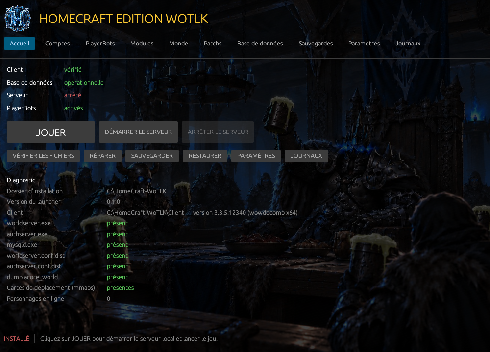
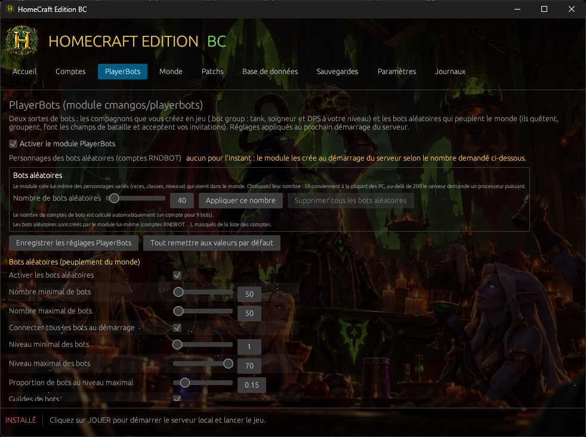
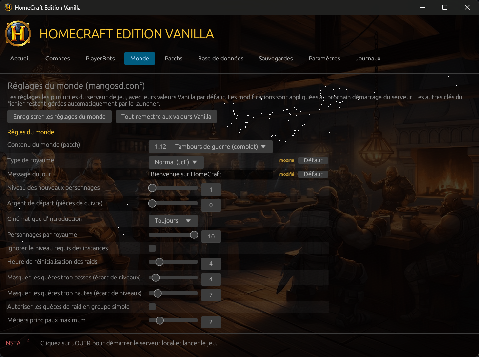
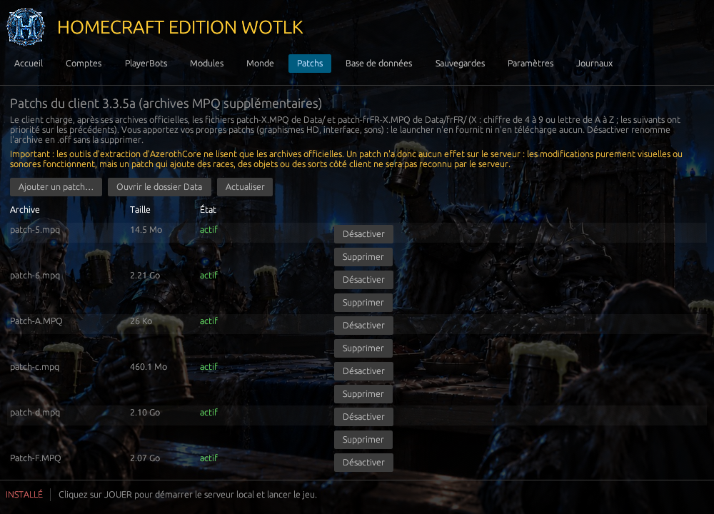
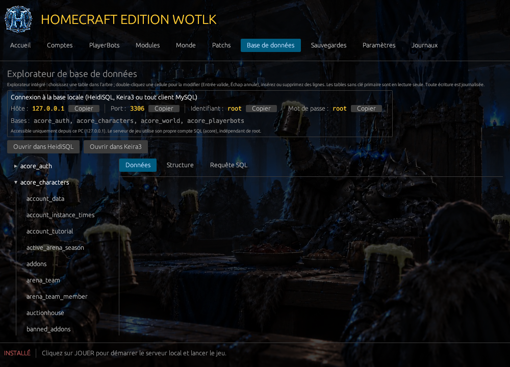
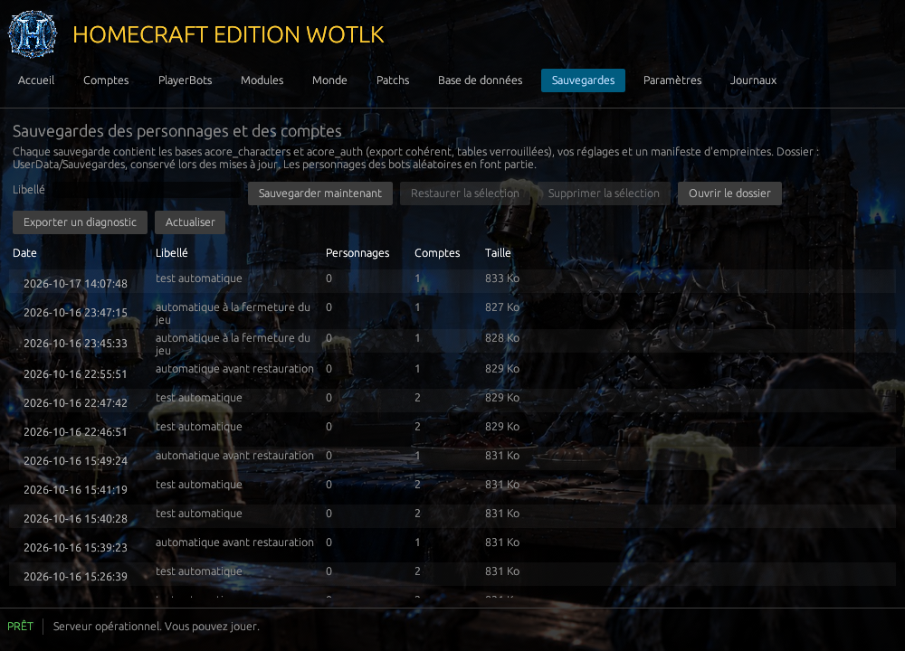
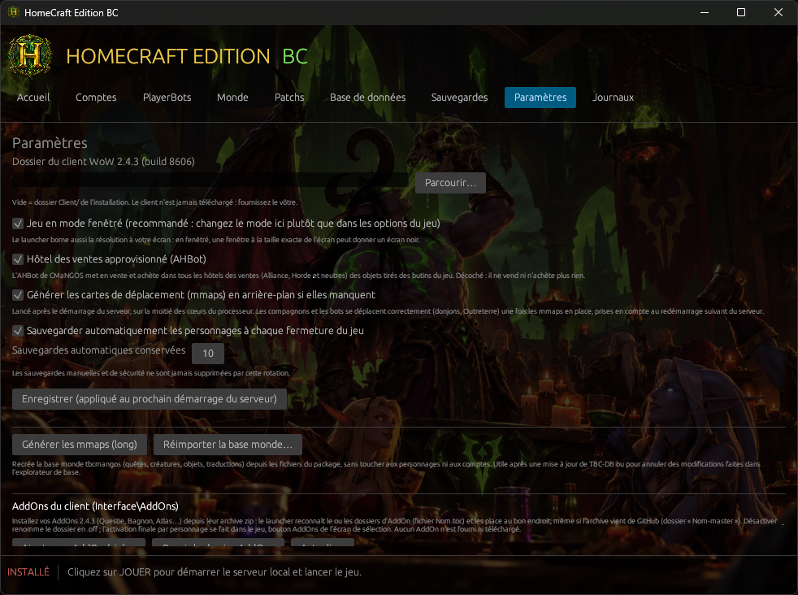
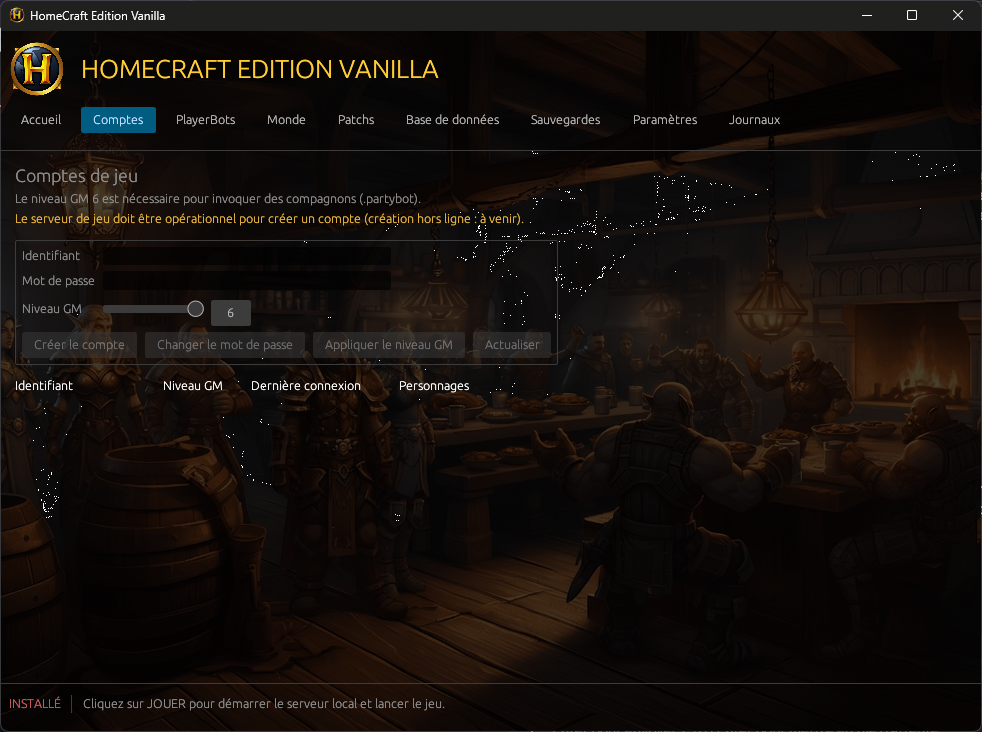

<p align="center">
  
</p>

<h1 align="center">HomeCraft Edition Vanilla</h1>

<p align="center">
  <strong>World of Warcraft 1.12.1 en solo, hors ligne, en français.</strong><br>
  Un serveur local automatisé, un monde peuplé de bots qui jouent comme des joueurs et un launcher à un seul bouton.
</p>

<p align="center">
  <a href="https://github.com/BlaMacfly/HomeCraft-Vanilla/releases">Télécharger la dernière version</a> ·
  <a href="Documentation/Manuel-Utilisateur.md">Manuel d'utilisation</a> ·
  <a href="Documentation/">Documentation technique</a> ·
  <a href="LICENCE.txt">Licence</a> ·
  <a href="https://discord.gg/M34APTbZ8R">Discord</a>
</p>

<p align="center">
  <a href="https://discord.gg/M34APTbZ8R"></a>
  <a href="https://github.com/BlaMacfly/HomeCraft-Vanilla/releases"></a>
</p>

> **English summary.** HomeCraft Edition Vanilla is a self-contained, offline, single-player package for World of Warcraft 1.12.1 (Vanilla): a local CMaNGOS Classic server with the playerbots module (a living world of bots that level, quest and group like players), a portable MariaDB database, a stocked auction house and a one-button Rust launcher that configures everything. The game client is **not** included and never will be: you need your own 1.12.1 client (French locale). Interface, documentation and launcher are in French. Source-available under a proprietary licence (personal use; viewing and forking on GitHub allowed; no redistribution of modified or compiled versions).

---

## Sommaire

- [Présentation](#présentation)
- [Captures d'écran](#captures-décran)
- [Fonctionnalités](#fonctionnalités)
- [Prérequis](#prérequis)
- [Installation et premier démarrage](#installation-et-premier-démarrage)
- [Jouer avec les bots](#jouer-avec-les-bots)
- [Ce dépôt et ce qu'il ne contient pas](#ce-dépôt-et-ce-quil-ne-contient-pas)
- [Construire depuis les sources](#construire-depuis-les-sources)
- [Tests](#tests)
- [Architecture](#architecture)
- [Documentation](#documentation)
- [Communauté et aide](#communauté-et-aide)
- [Licence et mentions légales](#licence-et-mentions-légales)

## Présentation

HomeCraft Edition Vanilla transforme un client World of Warcraft 1.12.1 en jeu solo complet, sans serveur distant, sans compte en ligne, sans rien installer dans Windows. Tout tient dans un dossier :

| Composant | Rôle |
|---|---|
| **CMaNGOS Classic** + module **playerbots** | serveur de jeu fidèle au patch 1.12, compilé par HomeCraft, avec des bots qui peuplent le monde et jouent comme des joueurs (quêtes, donjons, champs de bataille, groupes, guildes) |
| **MariaDB** portable | base de données du monde (classic-db) et des personnages, sur `127.0.0.1` uniquement |
| **Launcher HomeCraft** (Rust, egui) | démarre tout dans le bon ordre, configure le client, crée les comptes, sauvegarde, répare, et expose les réglages dans des onglets |
| **Compléments HomeCraft** | traductions françaises officielles reprises dans la base CMaNGOS et complétées (quêtes, dialogues, noms de créatures), hôtel des ventes approvisionné |

Le joueur fournit son propre client 1.12.1 en français ; le serveur en extrait les données nécessaires au premier démarrage.

## Captures d'écran

<table>
  <tr>
    <td align="center"><br><sub>Accueil : un bouton JOUER, l'état des services, vérification et réparation</sub></td>
    <td align="center"><br><sub>PlayerBots (capture de l'édition VMaNGOS, à refaire)</sub></td>
  </tr>
  <tr>
    <td align="center"><br><sub>Monde : 70 réglages du serveur avec leurs valeurs Vanilla par défaut</sub></td>
    <td align="center"><br><sub>Patchs : archives MPQ du client (graphismes HD…), activables à volonté</sub></td>
  </tr>
  <tr>
    <td align="center"><br><sub>Base de données : explorateur intégré façon HeidiSQL</sub></td>
    <td align="center"><br><sub>Sauvegardes : archives vérifiées, restauration, diagnostic</sub></td>
  </tr>
  <tr>
    <td align="center"><br><sub>Paramètres : client, affichage, VanillaFixes/DXVK, mmaps, sauvegarde automatique, AddOns</sub></td>
    <td align="center"><br><sub>Comptes : création, mot de passe, niveau GM, suppression</sub></td>
  </tr>
</table>

## Fonctionnalités

**Jouer**
- Un bouton **JOUER** : base de données → authentification → monde → configuration du client (`realmlist.wtf`, fenêtré, résolution bornée à l'écran) → lancement du jeu. Premier démarrage automatique (import des bases, extraction dbc/maps/vmaps), deux à cinq minutes une seule fois.
- **Un monde peuplé de bots** (module playerbots de CMaNGOS, le même système que les playerbots d'AzerothCore) : ils montent de niveau, font leurs quêtes, vont en donjon et en champ de bataille, forment des groupes et des guildes, parlent dans les canaux (en français pour un client français).
- **Grouper** : invitez un bot (il accepte quel que soit votre niveau), `.bot group` pour un groupe complet à votre niveau, `.bot add Nom` pour jouer avec vos autres personnages ; ordres dans le canal de groupe (follow, stay, attack, summon…).
- **Hôtel des ventes** approvisionné automatiquement (Alliance, Horde et gobelin).
- **Cartes de déplacement (mmaps)** générées en arrière-plan après le premier démarrage (un quart d'heure environ).

**Régler**
- Onglet **Monde** : expérience, butin, difficulté des créatures, Alliance et Horde sur le même compte, quêtes de raid en groupe simple, mode maître de jeu, etc. Valeurs Vanilla rappelées, retour aux défauts en un clic.
- Onglet **PlayerBots** : nombre de bots connectés, niveaux, groupes, guildes, discussions, invitations, performances ; appliqués sans redémarrer.
- **Patchs** client (`patch-X.MPQ`) : activer, désactiver, ajouter, et construire une archive MPQ depuis un dossier (patchs VanillaHD, par exemple).
- **AddOns** : installation depuis une archive zip (Questie, pfUI, Bagnon…), activation, suppression.
- **VanillaFixes** (fluidité) et **DXVK** (rendu Vulkan) en option.
- **Client 64 bits Benilla** reconnu en plus du client d'origine : détection automatique (« Rechercher les clients » dans Paramètres), configuration de son `config.toml`, AddOns dans `benilla-config\AddOns`.

**Protéger**
- **Sauvegardes** vérifiées par empreinte (personnages, comptes, réglages), automatiques à chaque fermeture du jeu avec rotation, sauvegarde de sécurité avant toute restauration.
- **Vérification** des fichiers par manifeste SHA-256, **réparation** (bases manquantes, configurations, données du client), **réimport de la base monde** sans perte de personnages, export de **diagnostic**.
- **Comptes** : création avec niveau GM, changement de mot de passe, suppression avec confirmation (personnages compris).
- **Base de données** : explorateur natif (grille éditable, structure, SQL avec confirmation d'écriture, historique) et bouton vers HeidiSQL.

**Tout en français** : interface du launcher, manuel, et textes du jeu (traductions officielles d'époque reprises de la base VMaNGOS dans la base CMaNGOS, complétées par HomeCraft là où elles manquaient : toutes les quêtes et tous les dialogues ont leur texte français).

## Prérequis

| Élément | Minimum |
|---|---|
| Système | Windows 10 ou 11, 64 bits |
| Processeur, mémoire | 4 cœurs, 8 Go |
| Espace disque | ≈ 4 Go pour HomeCraft, en plus du client |
| Client | World of Warcraft **1.12.1 frFR** (build 5875 ou 5880), fourni par vous ; ou [Benilla](https://github.com/samwhosung/benilla) (64 bits) avec les archives de ce client |
| Réseau | aucun : tout fonctionne hors ligne |

## Installation et premier démarrage

1. Téléchargez l'archive de la [dernière release](https://github.com/BlaMacfly/HomeCraft-Vanilla/releases) et décompressez-la dans un dossier de votre disque, par exemple `C:\Jeux\HomeCraft Edition Vanilla\` (pas dans Program Files, pas dans un dossier synchronisé en nuage).
2. Placez votre client 1.12.1 frFR dans le sous-dossier `Client\`, ou indiquez son emplacement dans Paramètres.
3. Ouvrez `HomeCraft Edition Vanilla.exe` et cliquez sur **JOUER**. Windows peut afficher « Éditeur inconnu » (certificat de signature personnel) : « Informations complémentaires » puis « Exécuter quand même ».
4. Créez votre compte dans l'onglet **Comptes** (niveau GM 3 pour disposer des commandes de maître de jeu), connectez-vous dans le jeu, créez un personnage. Le premier démarrage crée aussi les bots (quelques minutes).

Le [manuel d'utilisation](Documentation/Manuel-Utilisateur.md) détaille chaque étape, chaque onglet et le dépannage.

## Jouer avec les bots

```
/inviter Nom        invite un bot croisé dans le monde
.bot group          complète votre groupe avec des bots de classes complémentaires, à votre niveau
.bot add Nom        connecte un autre personnage de votre compte comme bot
/g follow | stay | attack | flee | summon | leave
```

Les bots suivent, soignent, tankent et attaquent d'eux-mêmes. Liste complète : [manuel, §9](Documentation/Manuel-Utilisateur.md#9-jouer-avec-les-bots).

## Ce dépôt et ce qu'il ne contient pas

Ce dépôt contient le **code source** du launcher, les scripts de construction, de test et d'exploitation, les compléments de base de données HomeCraft, la documentation et le manuel. Il ne contient **pas** :

- le client World of Warcraft ni aucun fichier qui en dérive (`Client/`, `Server/Data/`, patchs graphiques) : propriété de Blizzard Entertainment, jamais redistribués ;
- les binaires des composants tiers (MariaDB, HeidiSQL, VanillaFixes/DXVK) : ils sont figés par URL, version et empreinte SHA-256 dans [`Build/manifest.json`](Build/manifest.json) et récupérés par `Build/Get-Components.ps1` ; le serveur CMaNGOS et ses bases sont construits depuis les commits figés dans la même liste (`Build/Build-Cmangos.ps1`, `Build/Build-CmangosDb.ps1`) ; la **release** les inclut, avec leurs licences et les liens vers leurs sources exactes (`LICENCES/SOURCES.md`) ;
- les données personnelles (`UserData/`, journaux).

## Construire depuis les sources

Prérequis : Windows, [rustup](https://rustup.rs) (toolchain stable MSVC), Visual Studio Build Tools 2022 (charge « Développement Desktop C++ »), SDK Windows (`rc.exe`, `signtool.exe`), PowerShell 5.1.

```bash
# 1. Composants tiers (téléchargés dans Build/downloads, empreintes vérifiées)
powershell -ExecutionPolicy Bypass -File Build\Get-Components.ps1
# puis extraction selon Documentation/02-Construction.md (MariaDB -> Server/Database/mariadb,
# base VMaNGOS -> Server/Database/sql (source des traductions), HeidiSQL -> Tools/HeidiSQL, VanillaFixes -> Tools/VanillaFixes)

# 2. Serveur CMaNGOS + playerbots (Boost 1.87 téléchargé et vérifié, ~5 min) puis bases de données (Git Bash requis)
powershell -ExecutionPolicy Bypass -File Build\Build-Cmangos.ps1
powershell -ExecutionPolicy Bypass -File Build\Build-CmangosDb.ps1

# 3. Launcher
cd Launcher
cargo build --release

# 4. Signature (certificat de signature de code dans le magasin personnel)
powershell -ExecutionPolicy Bypass -Command "& Build\Sign-Launcher.ps1 -Thumbprint <empreinte> -NoDeploy"

# 5. Package portable (dossier + zip)
powershell -ExecutionPolicy Bypass -File Build\New-Package.ps1 -Zip
```

Les modifications du serveur sont publiées dans `Build/cmangos-patches` (build client 5880, option `-p` de mangosd, commande console `rndbot reload`).

## Tests

Scripts rejouables dans [`Tests/`](Tests/). Validés sur l'édition CMaNGOS (0.10) :

| Script | Vérifie |
|---|---|
| `Test-Integration` | copie du package : premier démarrage et création des bots, comptes, suppression hors ligne sans toucher aux autres personnages, vie des bots (expérience gagnée), réglages appliqués à chaud, suppression des bots serveur en marche, arrêt sans processus résiduel |
| `Test-Dependencies` | aucun programme du package ne dépend d'un « Visual C++ Redistributable » installé |

`Test-Launcher`, `Test-Phase5`, `Test-Package`, `Test-Localisation` et `Test-Offline` ont été écrits pour l'édition VMaNGOS (0.9.x) et restent à adapter.

Ne lancez jamais un test qui démarre ou arrête des services pendant que votre launcher est ouvert.

## Architecture

```
HomeCraft Edition Vanilla.exe     launcher Rust (eframe/egui 0.32, crate mysql pur Rust, aucune DLL)
├─ orchestrateur (thread dédié)   machine à états, surveillance, commandes depuis l'interface
├─ db.rs / server.rs / client.rs  MariaDB portable, realmd + mangosd (console sur stdin), client (realmlist, Config.wtf)
├─ backup.rs / repair.rs          sauvegardes vérifiées, manifeste de fichiers, extraction, mmaps, diagnostic
├─ conf_catalog.rs                catalogue des réglages exposés (aiplayerbot.conf : PlayerBots ; mangosd.conf : Monde)
├─ botgen.rs / patches.rs / addons.rs / mpqbuild.rs
└─ i18n.rs                        toutes les chaînes, en français
Server/   CMaNGOS (Server/cmangos), MariaDB, dumps (cmangos-sql), configurations générées, données extraites
UserData/ base vivante, réglages, sauvegardes (à conserver)
Tools/    scripts PowerShell d'exploitation (Common.ps1 : chemins, ports, SQL), HeidiSQL
Build/    manifeste des composants, signature, manifeste de fichiers, packaging
```

Détails dans `Documentation/04-Launcher-Exigences.md` et `Launcher/README.md`.

## Documentation

| Document | Contenu |
|---|---|
| [Manuel d'utilisation](Documentation/Manuel-Utilisateur.md) | tout ce que fait HomeCraft, onglet par onglet, dépannage, FAQ |
| [01 — Audit](Documentation/01-Audit-Phase1.md) | comparaison des cores, clients et bots, choix d'architecture, risques |
| [02 — Construction](Documentation/02-Construction.md) | composants figés, disposition, pièges VMaNGOS rencontrés |
| [03 — Tests phase 2](Documentation/03-Tests-Phase2.md) | journal des premiers tests et procédure en jeu |
| [04 — Launcher](Documentation/04-Launcher-Exigences.md) | exigences, décisions, fonctions ajoutées au fil du projet |
| [05 — Tests phases 4-5](Documentation/05-Tests-Phases4-5.md) | tests du launcher, sauvegarde, restauration, réparation |
| [06 — Packaging](Documentation/06-Packaging-Portable.md) | package portable, ISO, décisions de distribution |
| [07 — Pérennité du client](Documentation/07-Perennite-Client.md) | VanillaFixes, DXVK, Benilla |
| [08 — Patchs graphiques](Documentation/08-Patchs-Graphiques.md) | VanillaHD, constructeur MPQ, limites côté serveur |
| [09 — Localisation](Documentation/09-Localisation-Inventaire.md) | couverture française mesurée |
| [10 — Validation finale](Documentation/10-Validation-Finale.md) | critères, résultats, réserves |
| [11 — Licence PlayerBots](Documentation/11-Licence-PlayerBots.md) | statut du module playerbots (aucune licence publiée), demande aux auteurs |

## Communauté et aide

Questions, retours, aide à l'installation : rejoignez le serveur Discord **[discord.gg/M34APTbZ8R](https://discord.gg/M34APTbZ8R)**. Pour une demande d'aide, joignez le diagnostic exporté depuis l'onglet Sauvegardes du launcher.

## Licence et mentions légales

- **HomeCraft Edition Vanilla** (launcher, scripts, documentation, compléments de base de données, nom et logo) : © 2026 BlaMacfly, licence propriétaire [`LICENCE.txt`](LICENCE.txt). Usage personnel autorisé ; consultation et fork sur GitHub autorisés ; reproduction, redistribution (y compris de versions compilées), modification et usage commercial interdits sans accord écrit. Fourni sans garantie.
- **Composants tiers**, sous leurs licences propres : CMaNGOS (GPL-2.0), classic-db (GPL-3.0), module playerbots (aucune licence publiée : usage personnel, voir le document 11), OpenSSL (Apache-2.0), MariaDB (GPL-2.0), HeidiSQL (GPL-2.0), VanillaFixes (MIT), DXVK (zlib), bibliothèques Rust (MIT/Apache-2.0 et assimilées). Versions, commits et liens vers les sources dans `Build/manifest.json` et, dans la release, `LICENCES/SOURCES.md`.
- World of Warcraft et Blizzard Entertainment sont des marques de Blizzard Entertainment, Inc. HomeCraft est une création indépendante, sans lien avec Blizzard Entertainment. Le client du jeu n'est pas fourni : vous devez disposer du vôtre et respecter les conditions qui s'y appliquent.
