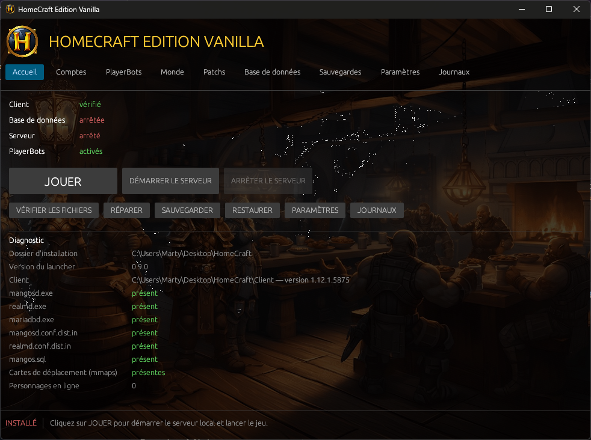
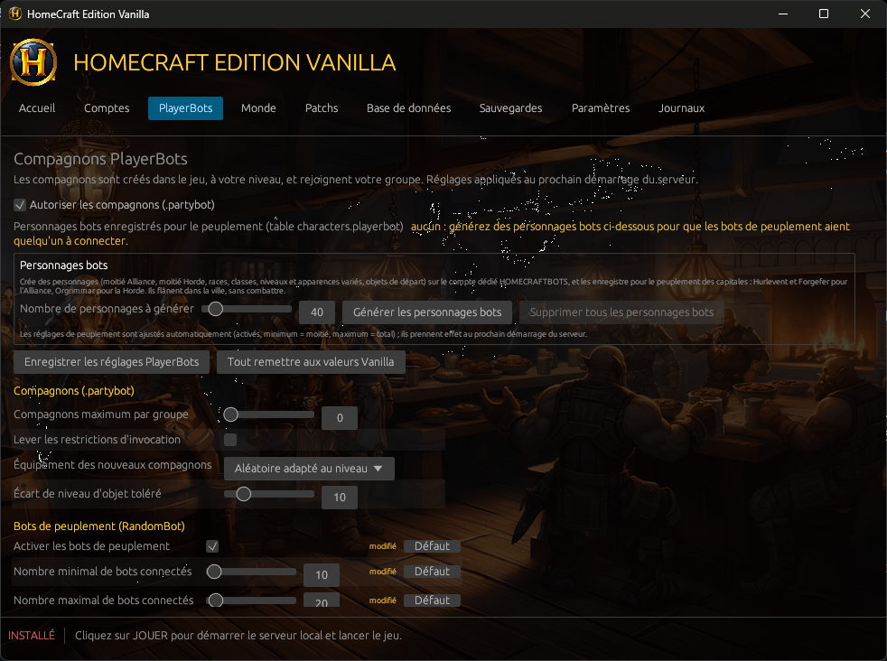
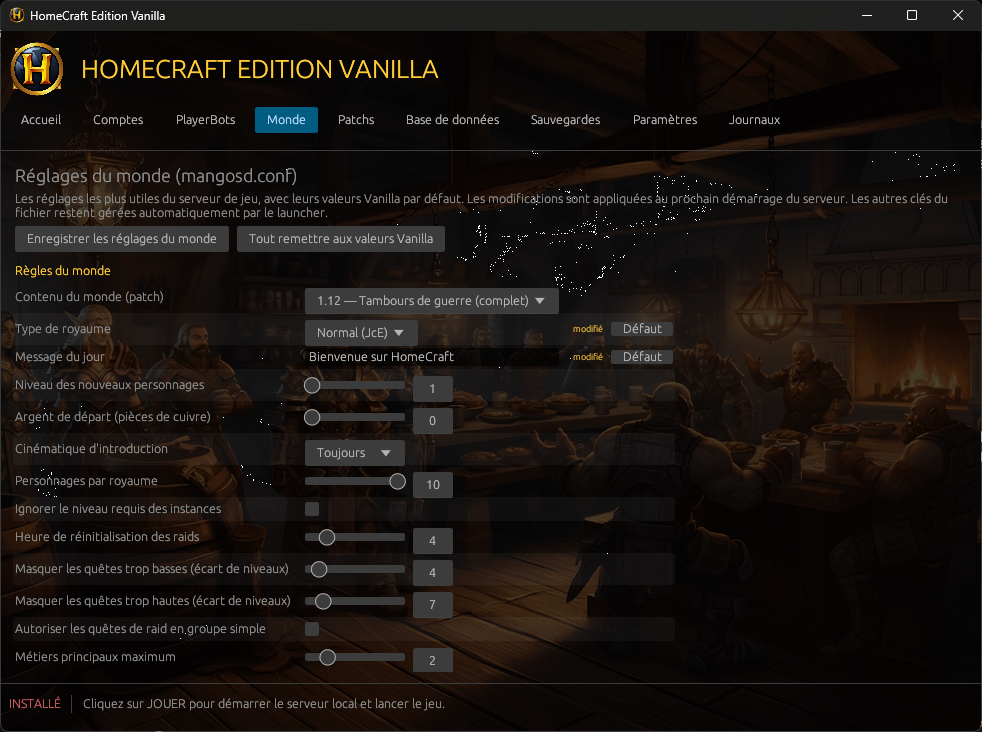
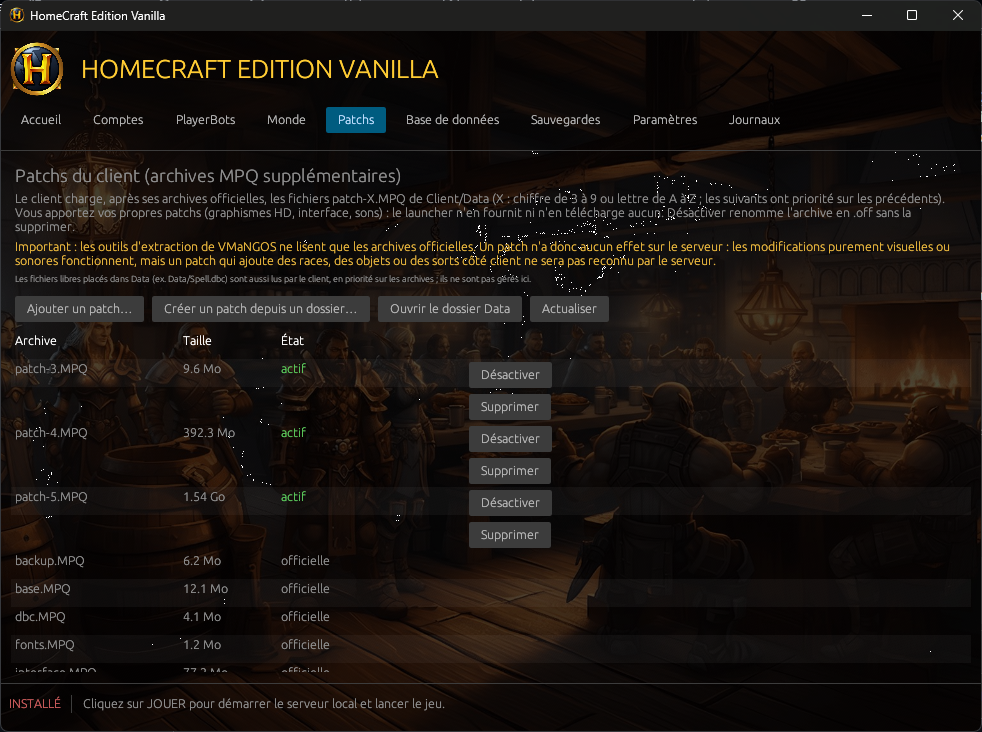
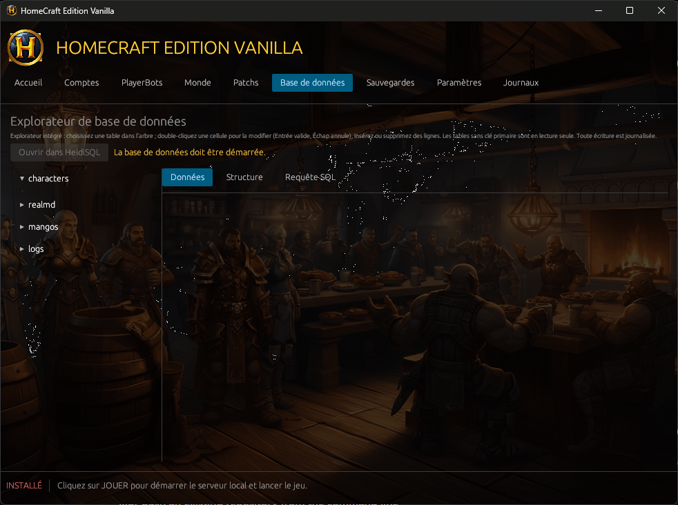
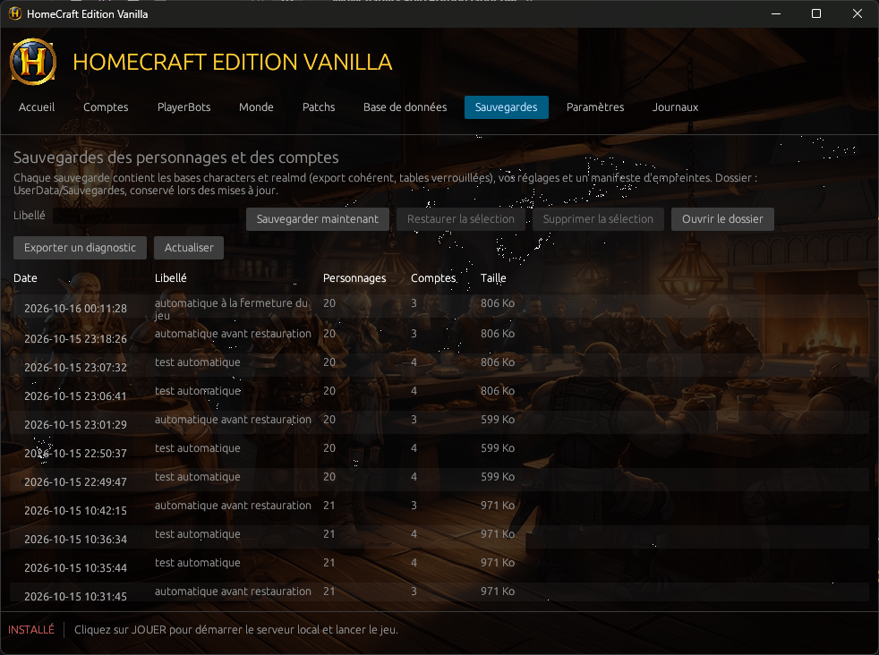
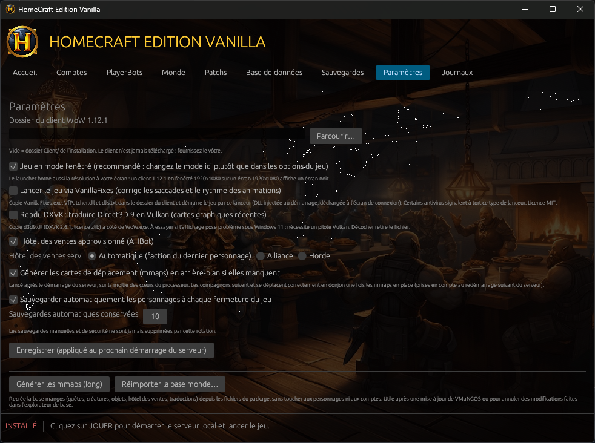
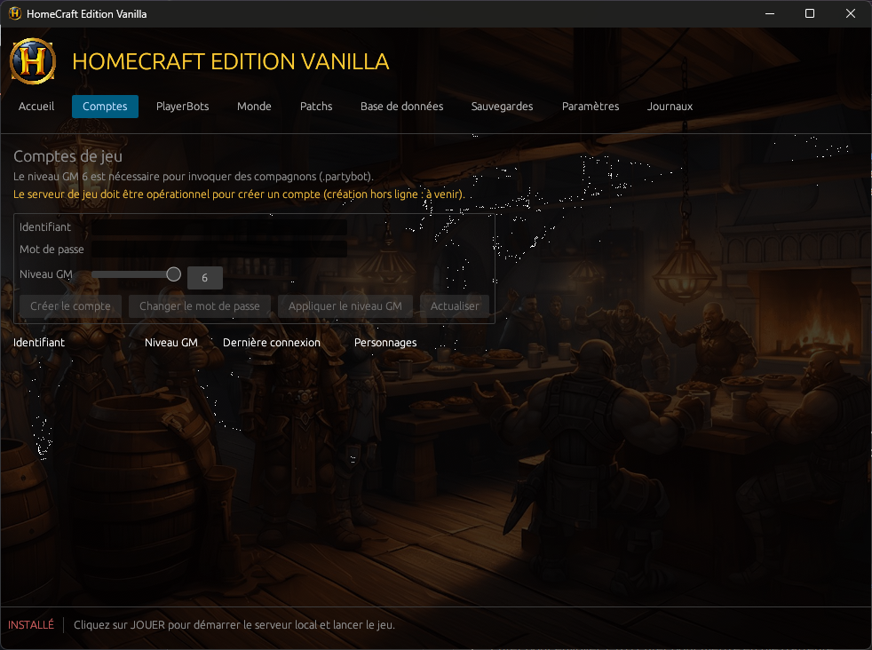

<p align="center">
  
</p>

<h1 align="center">HomeCraft Edition Vanilla</h1>

<p align="center">
  <strong>World of Warcraft 1.12.1 en solo, hors ligne, en français.</strong><br>
  Un serveur local automatisé, des compagnons contrôlés par l'ordinateur et un launcher à un seul bouton.
</p>

<p align="center">
  <a href="https://github.com/BlaMacfly/HomeCraft-Vanilla/releases">Télécharger la dernière version</a> ·
  <a href="Documentation/Manuel-Utilisateur.md">Manuel d'utilisation</a> ·
  <a href="Documentation/">Documentation technique</a> ·
  <a href="LICENCE.txt">Licence</a>
</p>

> **English summary.** HomeCraft Edition Vanilla is a self-contained, offline, single-player package for World of Warcraft 1.12.1 (Vanilla): a local VMaNGOS server with built-in PartyBots companions, a portable MariaDB database, a stocked auction house and a one-button Rust launcher that configures everything. The game client is **not** included and never will be: you need your own 1.12.1 client (French locale). Interface, documentation and launcher are in French. Source-available under a proprietary licence (personal use; viewing and forking on GitHub allowed; no redistribution of modified or compiled versions).

---

## Sommaire

- [Présentation](#présentation)
- [Captures d'écran](#captures-décran)
- [Fonctionnalités](#fonctionnalités)
- [Prérequis](#prérequis)
- [Installation et premier démarrage](#installation-et-premier-démarrage)
- [Jouer avec des compagnons](#jouer-avec-des-compagnons)
- [Ce dépôt et ce qu'il ne contient pas](#ce-dépôt-et-ce-quil-ne-contient-pas)
- [Construire depuis les sources](#construire-depuis-les-sources)
- [Tests](#tests)
- [Architecture](#architecture)
- [Documentation](#documentation)
- [Licence et mentions légales](#licence-et-mentions-légales)

## Présentation

HomeCraft Edition Vanilla transforme un client World of Warcraft 1.12.1 en jeu solo complet, sans serveur distant, sans compte en ligne, sans rien installer dans Windows. Tout tient dans un dossier :

| Composant | Rôle |
|---|---|
| **VMaNGOS** | serveur de jeu fidèle au patch 1.12, avec les **PartyBots** intégrés (compagnons tank, soigneur, DPS) |
| **MariaDB** portable | base de données du monde et des personnages, sur `127.0.0.1` uniquement |
| **Launcher HomeCraft** (Rust, egui) | démarre tout dans le bon ordre, configure le client, crée les comptes, sauvegarde, répare, et expose les réglages dans des onglets |
| **Compléments HomeCraft** | hôtel des ventes approvisionné (6 392 objets utiles en solo), traductions françaises complétées (quêtes, dialogues, noms de créatures) |

Le joueur fournit son propre client 1.12.1 en français ; le serveur en extrait les données nécessaires au premier démarrage.

## Captures d'écran

<table>
  <tr>
    <td align="center"><br><sub>Accueil : un bouton JOUER, l'état des services, vérification et réparation</sub></td>
    <td align="center"><br><sub>PlayerBots : réglages des compagnons, aide-mémoire des commandes, bots de peuplement</sub></td>
  </tr>
  <tr>
    <td align="center"><br><sub>Monde : 70 réglages du serveur avec leurs valeurs Vanilla par défaut</sub></td>
    <td align="center"><br><sub>Patchs : archives MPQ du client (graphismes HD…), activables à volonté</sub></td>
  </tr>
  <tr>
    <td align="center"><br><sub>Base de données : explorateur intégré façon HeidiSQL</sub></td>
    <td align="center"><br><sub>Sauvegardes : archives vérifiées, restauration, diagnostic</sub></td>
  </tr>
  <tr>
    <td align="center"><br><sub>Paramètres : client, affichage, VanillaFixes/DXVK, mmaps, sauvegarde automatique, AddOns</sub></td>
    <td align="center"><br><sub>Comptes : création, mot de passe, niveau GM, suppression</sub></td>
  </tr>
</table>

## Fonctionnalités

**Jouer**
- Un bouton **JOUER** : base de données → authentification → monde → configuration du client (`realmlist.wtf`, fenêtré, résolution bornée à l'écran) → lancement du jeu. Premier démarrage automatique (import des bases, extraction dbc/maps/vmaps), deux à cinq minutes une seule fois.
- **Compagnons PartyBots** : `.partybot add tank | healer | dps` dans le chat, puis cometome, pull, marques, pause… Toutes les commandes dans le manuel et dans l'onglet PlayerBots.
- **Bots de peuplement** : génération de personnages bots qui flânent dans les capitales.
- **Hôtel des ventes** approvisionné automatiquement pour votre faction.
- **Cartes de déplacement (mmaps)** générées en arrière-plan après le premier démarrage, pour des compagnons qui se déplacent correctement en donjon.

**Régler**
- Onglet **Monde** : expérience, butin, difficulté des créatures, Alliance et Horde sur le même compte, quêtes de raid en groupe simple, contenu par patch (1.2 → 1.12), mode maître de jeu, etc. Valeurs Vanilla rappelées, retour aux défauts en un clic.
- Onglet **PlayerBots** : nombre de compagnons, équipement, restrictions d'invocation, visibilité, champs de bataille.
- **Patchs** client (`patch-X.MPQ`) : activer, désactiver, ajouter, et construire une archive MPQ depuis un dossier (patchs VanillaHD, par exemple).
- **AddOns** : installation depuis une archive zip (Questie, pfUI, Bagnon…), activation, suppression.
- **VanillaFixes** (fluidité) et **DXVK** (rendu Vulkan) en option.

**Protéger**
- **Sauvegardes** vérifiées par empreinte (personnages, comptes, réglages), automatiques à chaque fermeture du jeu avec rotation, sauvegarde de sécurité avant toute restauration.
- **Vérification** des fichiers par manifeste SHA-256, **réparation** (bases manquantes, configurations, données du client), **réimport de la base monde** sans perte de personnages, export de **diagnostic**.
- **Comptes** : création avec niveau GM, changement de mot de passe, suppression avec confirmation (personnages compris).
- **Base de données** : explorateur natif (grille éditable, structure, SQL avec confirmation d'écriture, historique) et bouton vers HeidiSQL.

**Tout en français** : interface du launcher, manuel, et textes du jeu (traductions officielles d'époque de la base VMaNGOS, complétées par HomeCraft là où elles manquaient : 0 quête réelle, 0 dialogue de PNJ et 0 créature visible sans texte français).

## Prérequis

| Élément | Minimum |
|---|---|
| Système | Windows 10 ou 11, 64 bits |
| Processeur, mémoire | 4 cœurs, 8 Go |
| Espace disque | ≈ 4 Go pour HomeCraft, en plus du client |
| Client | World of Warcraft **1.12.1 frFR** (build 5875 ou 5880), fourni par vous |
| Réseau | aucun : tout fonctionne hors ligne |

## Installation et premier démarrage

1. Téléchargez l'archive de la [dernière release](https://github.com/BlaMacfly/HomeCraft-Vanilla/releases) et décompressez-la dans un dossier de votre disque, par exemple `C:\Jeux\HomeCraft Edition Vanilla\` (pas dans Program Files, pas dans un dossier synchronisé en nuage).
2. Placez votre client 1.12.1 frFR dans le sous-dossier `Client\`, ou indiquez son emplacement dans Paramètres.
3. Ouvrez `HomeCraft Edition Vanilla.exe` et cliquez sur **JOUER**. Windows peut afficher « Éditeur inconnu » (certificat de signature personnel) : « Informations complémentaires » puis « Exécuter quand même ».
4. Créez votre compte dans l'onglet **Comptes** (niveau GM 6 pour les compagnons), connectez-vous dans le jeu, créez un personnage.

Le [manuel d'utilisation](Documentation/Manuel-Utilisateur.md) détaille chaque étape, chaque onglet et le dépannage.

## Jouer avec des compagnons

```
.partybot add tank
.partybot add healer
.partybot add dps
.partybot cometome      .partybot pull      .partybot pause / unpause      .partybot remove
```

Les compagnons sont créés à votre niveau, rejoignent votre groupe, soignent, tankent et attaquent d'eux-mêmes. Liste complète des commandes : [manuel, §9](Documentation/Manuel-Utilisateur.md#9-jouer-en-solo-avec-des-compagnons).

## Ce dépôt et ce qu'il ne contient pas

Ce dépôt contient le **code source** du launcher, les scripts de construction, de test et d'exploitation, les compléments de base de données HomeCraft, la documentation et le manuel. Il ne contient **pas** :

- le client World of Warcraft ni aucun fichier qui en dérive (`Client/`, `Server/Data/`, patchs graphiques) : propriété de Blizzard Entertainment, jamais redistribués ;
- les binaires des composants tiers (VMaNGOS, MariaDB, HeidiSQL, VanillaFixes/DXVK) : ils sont figés par URL, version et empreinte SHA-256 dans [`Build/manifest.json`](Build/manifest.json) et récupérés par `Build/Get-Components.ps1` ; la **release** les inclut, avec leurs licences et les liens vers leurs sources exactes (`LICENCES/SOURCES.md`) ;
- les données personnelles (`UserData/`, journaux).

## Construire depuis les sources

Prérequis : Windows, [rustup](https://rustup.rs) (toolchain stable MSVC), Visual Studio Build Tools 2022 (charge « Développement Desktop C++ »), SDK Windows (`rc.exe`, `signtool.exe`), PowerShell 5.1.

```bash
# 1. Composants tiers (téléchargés dans Build/downloads, empreintes vérifiées)
powershell -ExecutionPolicy Bypass -File Build\Get-Components.ps1
# puis extraction selon Documentation/02-Construction.md (VMaNGOS -> Server/vmangos, MariaDB -> Server/Database/mariadb,
# dumps -> Server/Database/sql, HeidiSQL -> Tools/HeidiSQL, VanillaFixes -> Tools/VanillaFixes)

# 2. Launcher
cd Launcher
cargo build --release

# 3. Signature et déploiement à la racine (certificat de signature de code dans le magasin personnel)
powershell -ExecutionPolicy Bypass -Command "& Build\Sign-Launcher.ps1 -Thumbprint <empreinte>"
powershell -ExecutionPolicy Bypass -File Build\New-FilesManifest.ps1

# 4. Package portable (dossier + zip) et, si besoin, image ISO
powershell -ExecutionPolicy Bypass -File Build\New-Package.ps1 -Zip
```

Le patch de compatibilité du client build 5880 (`Build/Patch-MangosdBuilds.ps1`) et la table de l'hôtel des ventes (`Tools/New-AHBotTable.ps1`) sont reproductibles ; voir `Documentation/02-Construction.md`.

## Tests

Scripts rejouables dans [`Tests/`](Tests/), tous verts sur la version 0.9.0 :

| Script | Vérifie |
|---|---|
| `Test-Launcher` | démarrage complet par le launcher, arrêt propre, ports libérés, aucun orphelin, aucune erreur |
| `Test-Phase5` | sauvegarde, vérification des fichiers, réparation, réimport de la base monde, restauration, diagnostic (20 contrôles) |
| `Test-Package` | installation vierge depuis le package, premier démarrage, arrêt brutal puis redémarrage, compléments SQL appliqués, ISO |
| `Test-Localisation` | couverture française des tables du monde, inventaire dans `Documentation/09-Localisation-Inventaire.md` |
| `Test-Offline` | services sur 127.0.0.1 seulement, aucune connexion sortante, aucune bibliothèque réseau dans le launcher |

Ne lancez jamais un test qui démarre ou arrête des services pendant que votre launcher est ouvert.

## Architecture

```
HomeCraft Edition Vanilla.exe     launcher Rust (eframe/egui 0.32, crate mysql pur Rust, aucune DLL)
├─ orchestrateur (thread dédié)   machine à états, surveillance, commandes depuis l'interface
├─ db.rs / server.rs / client.rs  MariaDB portable, realmd + mangosd (console sur stdin), client (realmlist, Config.wtf)
├─ backup.rs / repair.rs          sauvegardes vérifiées, manifeste de fichiers, extraction, mmaps, diagnostic
├─ conf_catalog.rs                catalogue des réglages mangosd.conf exposés (PlayerBots, Monde)
├─ botgen.rs / patches.rs / addons.rs / mpqbuild.rs
└─ i18n.rs                        toutes les chaînes, en français
Server/   VMaNGOS, MariaDB, dumps, compléments SQL, configurations générées, données extraites
UserData/ base vivante, réglages, sauvegardes (à conserver)
Tools/    scripts PowerShell d'exploitation (Common.ps1 : chemins, ports, SQL), HeidiSQL
Build/    manifeste des composants, signature, manifeste de fichiers, packaging
```

Détails dans `Documentation/04-Launcher-Exigences.md` et `Launcher/README.md`.

## Documentation

| Document | Contenu |
|---|---|
| [Manuel d'utilisation](Documentation/Manuel-Utilisateur.md) | tout ce que fait HomeCraft, onglet par onglet, dépannage, FAQ |
| [01 — Audit](Documentation/01-Audit-Phase1.md) | comparaison des cores, clients et bots, choix d'architecture, risques |
| [02 — Construction](Documentation/02-Construction.md) | composants figés, disposition, pièges VMaNGOS rencontrés |
| [03 — Tests phase 2](Documentation/03-Tests-Phase2.md) | journal des premiers tests et procédure en jeu |
| [04 — Launcher](Documentation/04-Launcher-Exigences.md) | exigences, décisions, fonctions ajoutées au fil du projet |
| [05 — Tests phases 4-5](Documentation/05-Tests-Phases4-5.md) | tests du launcher, sauvegarde, restauration, réparation |
| [06 — Packaging](Documentation/06-Packaging-Portable.md) | package portable, ISO, décisions de distribution |
| [07 — Pérennité du client](Documentation/07-Perennite-Client.md) | VanillaFixes, DXVK, Benilla |
| [08 — Patchs graphiques](Documentation/08-Patchs-Graphiques.md) | VanillaHD, constructeur MPQ, limites côté serveur |
| [09 — Localisation](Documentation/09-Localisation-Inventaire.md) | couverture française mesurée |
| [10 — Validation finale](Documentation/10-Validation-Finale.md) | critères, résultats, réserves |

## Licence et mentions légales

- **HomeCraft Edition Vanilla** (launcher, scripts, documentation, compléments de base de données, nom et logo) : © 2026 BlaMacfly, licence propriétaire [`LICENCE.txt`](LICENCE.txt). Usage personnel autorisé ; consultation et fork sur GitHub autorisés ; reproduction, redistribution (y compris de versions compilées), modification et usage commercial interdits sans accord écrit. Fourni sans garantie.
- **Composants tiers**, sous leurs licences propres : VMaNGOS (GPL-2.0), MariaDB (GPL-2.0), HeidiSQL (GPL-2.0), VanillaFixes (MIT), DXVK (zlib), bibliothèques Rust (MIT/Apache-2.0 et assimilées). Versions, commits et liens vers les sources dans `Build/manifest.json` et, dans la release, `LICENCES/SOURCES.md`.
- World of Warcraft et Blizzard Entertainment sont des marques de Blizzard Entertainment, Inc. HomeCraft est une création indépendante, sans lien avec Blizzard Entertainment. Le client du jeu n'est pas fourni : vous devez disposer du vôtre et respecter les conditions qui s'y appliquent.
