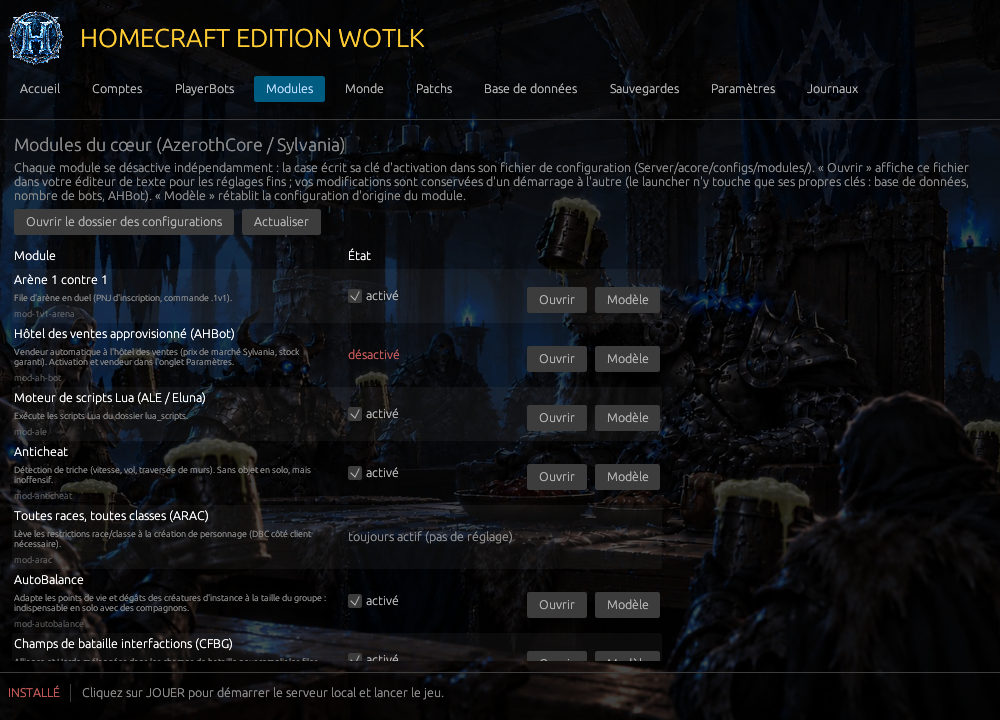

<p align="center">
  
</p>

<h1 align="center">HomeCraft Edition WoTLK</h1>

<p align="center">
  <strong>World of Warcraft 3.3.5a en solo, hors ligne, avec des bots joueurs.</strong><br>
  Le royaume « The Kingdom of Sylvania » sur votre PC, un serveur local automatisé et un launcher à un seul bouton.
</p>

<p align="center">
  <a href="Documentation/">Documentation technique</a> ·
  <a href="LICENCE.txt">Licence</a> ·
  <a href="https://github.com/BlaMacfly/HomeCraft-Vanilla">Édition Vanilla (branche main)</a> ·
  <a href="https://discord.gg/M34APTbZ8R">Discord</a>
</p>

<p align="center">
  <a href="https://discord.gg/M34APTbZ8R"></a>
  
  
</p>

> **English summary.** HomeCraft Edition WoTLK is a self-contained, offline, single-player package for World of Warcraft 3.3.5a (Wrath of the Lich King), the WotLK sibling of HomeCraft Edition Vanilla. It runs a local AzerothCore server (the core of the "Kingdom of Sylvania" realm, with its custom modules) with **mod-playerbots** built in, a portable MySQL database and a one-button Rust launcher. The game client is **not** included and never will be: you need your own 3.3.5a client. Interface and documentation are in French. **Work in progress: no release yet.** Source-available under a proprietary licence.

---

## Sommaire

- [Présentation](#présentation)
- [Captures d'écran](#captures-décran)
- [Fonctionnalités](#fonctionnalités)
- [État du projet](#état-du-projet)
- [Prérequis](#prérequis)
- [Jouer avec les bots](#jouer-avec-les-bots)
- [Ce dépôt et ce qu'il ne contient pas](#ce-dépôt-et-ce-quil-ne-contient-pas)
- [Construire depuis les sources](#construire-depuis-les-sources)
- [Tests](#tests)
- [Architecture](#architecture)
- [Documentation](#documentation)
- [Licence et mentions légales](#licence-et-mentions-légales)

## Présentation

HomeCraft Edition WoTLK est la déclinaison *Wrath of the Lich King* de [HomeCraft Edition Vanilla](https://github.com/BlaMacfly/HomeCraft-Vanilla) : même principe, même launcher, même disposition, mais sur le cœur du royaume **The Kingdom of Sylvania**. Tout tient dans un dossier, sans serveur distant ni compte en ligne :

| Composant | Rôle |
|---|---|
| **AzerothCore** (fork Sylvania) | serveur de jeu 3.3.5a avec les 24 modules du royaume (AutoBalance, Solocraft, Mythique +, transmogrification, hôtel des ventes approvisionné…) |
| **mod-playerbots** | bots joueurs : population aléatoire qui quête, voyage, fait donjons et champs de bataille, et compagnons à inviter dans votre groupe |
| **MySQL 8.4** portable | bases du monde, des personnages, des comptes et des bots, sur `127.0.0.1` uniquement |
| **Launcher HomeCraft** (Rust, egui) | démarre tout dans le bon ordre, configure le client, crée les comptes, sauvegarde, répare, et expose les réglages dans des onglets |

Le joueur fournit son propre client 3.3.5a ; le serveur en extrait les données nécessaires (cartes, collisions, cartes de déplacement des bots).

## Captures d'écran

<table>
  <tr>
    <td align="center"><br><sub>Accueil : un bouton JOUER, l'état des services, vérification et réparation</sub></td>
    <td align="center"><br><sub>PlayerBots : nombre de bots, comportement, aide-mémoire des commandes</sub></td>
  </tr>
  <tr>
    <td align="center"><br><sub>Modules : chaque module du cœur activable séparément, accès direct à sa configuration</sub></td>
    <td align="center"><br><sub>Monde : les réglages utiles du serveur avec leurs valeurs par défaut</sub></td>
  </tr>
  <tr>
    <td align="center"><br><sub>Base de données : explorateur intégré, paramètres de connexion, HeidiSQL et Keira3</sub></td>
    <td align="center"><br><sub>Sauvegardes : archives vérifiées, restauration, diagnostic</sub></td>
  </tr>
  <tr>
    <td align="center"><br><sub>Paramètres : client, affichage, hôtel des ventes, mmaps, sauvegarde automatique</sub></td>
    <td align="center"><br><sub>Comptes : création, mot de passe, niveau GM, suppression</sub></td>
  </tr>
</table>

<p align="center"><br><sub>Patchs et AddOns : archives MPQ du client et AddOns installés depuis leur zip</sub></p>

## Fonctionnalités

**Jouer**
- Un bouton **JOUER** : base de données → authentification → monde → configuration du client (`realmlist.wtf`, `Config.wtf`, fenêtré, résolution bornée à l'écran) → lancement du jeu.
- **Bots joueurs** (mod-playerbots) : 40 bots aléatoires par défaut (réglable de 0 à 500), créés et connectés par le serveur ; compagnons à inviter avec `.playerbots bot add`.
- **Modules du royaume Sylvania**, activables un par un depuis le launcher : AutoBalance et Solocraft (instances adaptées au solo), Mythique +, modes défi, transmogrification, services de personnage, arène 1 contre 1, et d'autres.
- **Cartes de déplacement (mmaps)** générées en arrière-plan, indispensables aux déplacements des bots.

**Régler**
- Onglet **PlayerBots** : nombre de bots, niveaux, cartes, quêtes, Recherche de donjon, champs de bataille, guildes, performance.
- Onglet **Modules** : une case par module, bouton « Ouvrir » vers son fichier de configuration, retour au modèle d'origine.
- Onglet **Monde** : expérience, butin, difficulté des créatures, factions, maître de jeu, distance d'affichage… avec retour aux défauts en un clic.
- **Patchs** client (`patch-X.MPQ`) et **AddOns** (installation depuis un zip, activation, suppression).

**Protéger et administrer**
- **Sauvegardes** vérifiées par empreinte (personnages, comptes, réglages), automatiques à chaque fermeture du jeu avec rotation, sauvegarde de sécurité avant toute restauration.
- **Vérification**, **réparation** (bases manquantes, configurations, données du client), **réimport de la base monde** sans perte de personnages, export de **diagnostic**.
- **Comptes** : création avec niveau GM (0 à 3), changement de mot de passe, suppression avec confirmation.
- **Base de données** : explorateur natif (grille éditable, structure, SQL), paramètres de connexion affichés, boutons vers **HeidiSQL** et **Keira3** (éditeur de la base monde AzerothCore, version 3.10.5 compilée pour correspondre au schéma du cœur).

## État du projet

**En développement, aucune release pour l'instant.** Ce qui est validé :

- cœur compilé sous Windows (MSVC 2022) avec mod-playerbots, base du royaume 1 « Semi Blizzlike » importée, monde chargé en moins de deux minutes, bots connectés ;
- launcher : démarrage et arrêt propres des trois services, sauvegarde, vérification, réparation, restauration, diagnostic, onglet Modules (tests `Tests/`, tous verts) ;
- bouton JOUER avec un client 3.3.5a jusqu'à l'écran de connexion.

En cours : client **WotLK Classic 3.4.3** via HermesProxy et Arctium, package portable, manuel d'utilisation.

## Prérequis

| Élément | Minimum |
|---|---|
| Système | Windows 10 ou 11, 64 bits |
| Processeur, mémoire | 4 cœurs, 8 Go (16 Go conseillés avec beaucoup de bots) |
| Client | World of Warcraft **3.3.5a** (build 12340), fourni par vous ; le client open source décompilé *wowdecomp* x64 est aussi reconnu |
| Réseau | aucun : tout fonctionne hors ligne, tous les services écoutent sur `127.0.0.1` |

## Jouer avec les bots

```
.playerbots bot add <nom>                 invite un bot (ou un de vos personnages hors ligne)
.playerbots bot addclass tank | heal | dps
/w <bot> follow | stay | attack | summon  ordres par murmure
/w <bot> help                             aide complète du bot
```

L'aide-mémoire complet est dans l'onglet PlayerBots du launcher.

## Ce dépôt et ce qu'il ne contient pas

Cette branche (`HomeCraft-WoTLK`) contient le **code source** du launcher, les scripts d'exploitation, de construction et de test, les patchs du cœur pour mod-playerbots, le manifeste des composants et la documentation. Elle ne contient **pas** :

- le client World of Warcraft ni aucun fichier qui en dérive (`Client/`, `Server/Data/`) : propriété de Blizzard Entertainment, jamais redistribués ;
- les binaires compilés et les composants tiers (serveur AzerothCore, MySQL, HeidiSQL, Keira3) ni les dumps de la base du royaume ;
- les données personnelles (`UserData/`, journaux).

## Construire depuis les sources

Prérequis : Windows, Visual Studio Build Tools 2022, CMake, Boost 1.87, OpenSSL 3.5, client MySQL 8.4, Git, [rustup](https://rustup.rs) (toolchain stable MSVC). Versions exactes dans [`Build/build-tools.json`](Build/build-tools.json).

```bash
# 1. Cœur AzerothCore (fork Sylvania) avec le patch Playerbot d'avril 2026 et mod-playerbots
powershell -ExecutionPolicy Bypass -File Build\Build-Core.ps1

# 2. Launcher
cd Launcher
cargo build --release
```

Le détail (choix du patch Playerbot, correctifs MSVC, jonctions de chemins courts, base MySQL, premier démarrage) est dans [`Documentation/02-Coeur-Playerbots.md`](Documentation/02-Coeur-Playerbots.md) et [`Documentation/03-Phase2-Serveur-local.md`](Documentation/03-Phase2-Serveur-local.md).

## Tests

Scripts rejouables dans [`Tests/`](Tests/) :

| Script | Vérifie |
|---|---|
| `Test-Launcher` | démarrage complet par le launcher, ports, écoute sur 127.0.0.1 seulement, arrêt propre, aucun orphelin, aucune erreur |
| `Test-Phase5` | sauvegarde, vérification des fichiers, réparation, restauration avec sauvegarde de sécurité, diagnostic (mots de passe masqués) |
| `Test-Play` | bouton JOUER de bout en bout : services, configuration et lancement du client, sauvegarde automatique à la fermeture du jeu |

Ne lancez jamais un test qui démarre ou arrête des services pendant que votre launcher est ouvert.

## Architecture

```
HomeCraft Edition WoTLK.exe        launcher Rust (eframe/egui 0.32, crate mysql pur Rust)
├─ orchestrator.rs                 machine à états, surveillance, commandes depuis l'interface
├─ db.rs / server.rs / client.rs   MySQL portable, authserver + worldserver (console sur stdin), client 3.3.5a / 3.4.3
├─ backup.rs / repair.rs           sauvegardes vérifiées, manifeste de fichiers, extraction, mmaps, diagnostic
├─ conf_catalog.rs                 réglages exposés (worldserver.conf, playerbots.conf)
├─ modules_catalog.rs              modules du cœur et leurs clés d'activation
├─ patches.rs / addons.rs
└─ i18n.rs                         toutes les chaînes, en français
Server/   AzerothCore et ses configurations, MySQL, dumps, données extraites du client
UserData/ base vivante, réglages, sauvegardes (à conserver)
Tools/    scripts PowerShell d'exploitation (Common.ps1 : chemins, ports, SQL), HeidiSQL, Keira3
Build/    compilation du cœur, patchs Playerbot, manifeste des composants
```

## Documentation

| Document | Contenu |
|---|---|
| [00 — Analyse et cadrage](Documentation/00-Analyse-HomeCraft-et-cadrage.md) | ce qui est repris de l'édition Vanilla, clients 3.3.5a et 3.4.3, plan |
| [02 — Cœur et Playerbots](Documentation/02-Coeur-Playerbots.md) | le fork Sylvania, la voie Playerbot retenue, la compilation |
| [03 — Serveur local](Documentation/03-Phase2-Serveur-local.md) | MySQL, extraction du client, premier démarrage, pièges des dumps |
| [04 — Launcher : exigences](Documentation/04-Launcher-Exigences.md) | cahier des charges et adaptations WoTLK |
| [05 — Launcher Rust](Documentation/05-Launcher-Rust.md) | changements par module, onglet Modules |
| [06 — Tests du launcher](Documentation/06-Tests-Launcher.md) | premier lancement réel, fiabilité, bouton JOUER |
| [07 — Keira3](Documentation/07-Keira3.md) | choix de la version compatible, connexion à la base |

## Licence et mentions légales

- **HomeCraft Edition WoTLK** (launcher, scripts, documentation, nom, logo et visuels) : © 2026 BlaMacfly, licence propriétaire [`LICENCE.txt`](LICENCE.txt). Usage personnel autorisé ; consultation et fork sur GitHub autorisés ; reproduction, redistribution (y compris de versions compilées), modification et usage commercial interdits sans accord écrit. Fourni sans garantie.
- **Composants tiers**, sous leurs licences propres : AzerothCore (GPL-2.0), mod-playerbots (AGPL-3.0), MySQL Community (GPL-2.0), HeidiSQL (GPL-2.0), Keira3 (AGPL-3.0), HermesProxy (GPL-3.0), bibliothèques Rust (MIT/Apache-2.0 et assimilées). Versions et sources dans [`Build/manifest.json`](Build/manifest.json) et la documentation.
- World of Warcraft et Blizzard Entertainment sont des marques de Blizzard Entertainment, Inc. HomeCraft est une création indépendante, sans lien avec Blizzard Entertainment. Le client du jeu n'est pas fourni : vous devez disposer du vôtre et respecter les conditions qui s'y appliquent.
